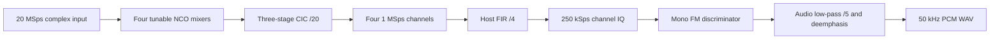

# RF observatory

Record one wideband bladeRF window, select up to four receiver channels, and
compare a fixed-point FPGA model with a floating-point reference. The first
application is mono broadcast-FM reception. The project includes synthesizable
VHDL for the channel bank, explicit hardware-to-host framing, and an integration
patch for the pinned bladeRF micro hosted design.

The normal `capture` command uses the ordinary hosted image. Software reference
outputs and successful HDL simulation do not establish that custom gateware was
fitted, loaded, or tested on a board. Board synthesis and hardware qualification
are separate steps described in the [HDL guide](hdl/README.md).

## Processing stages



Rust implements capture orchestration, file parsing, reference DSP and HDL
verification. VHDL describes the clocked FPGA datapath and integrates directly
with Nuand's existing VHDL design and Quartus flow. The upstream build system
retains its own languages. This hardware-description scope does not change the
workspace's Rust policy for host software.

## Build and check

Use the pinned workspace toolchain and initialize the upstream source checkouts:

```sh
git submodule update --init --recursive
cargo build --locked --release -p rf-observatory -p bladerf-lab
target/release/rf-observatory doctor
```

The Rust application does not link a native SDR library. Live acquisition
launches the separately built `bladerf-lab` radio adapter, which needs the
[native receive stack](../../docs/SETUP.md). Saved-IQ processing and fixture
generation require no radio. HDL verification additionally needs **GHDL 3.0.0**
or a separately qualified compatible version. The tested host target is Linux;
process supervision and private file modes use Unix interfaces.

## Record and inspect a wideband window

```sh
target/release/rf-observatory capture --center-mhz 98 --duration 0.5 --antenna 1 --gain 40 --output captures/observatory
target/release/rf-observatory survey captures/observatory/wideband.sc16q11 --center-mhz 98 --output artifacts/observatory-spectrum
```

Select the receive connector carrying the intended feed. Acquisition uses
20,000,000 complex samples/s and little-endian, interleaved SC16 Q11. Each sample
occupies four bytes; one second is 80,000,000 bytes. Duration is bounded to ten
seconds and must provide at least 8,192 samples for spectrum analysis.

The acquisition sidecar retains actual tuning, rate, bandwidth, gain and start
time. The wrapper validates sample representation, settings and completed byte
length. RF tuning readback can differ slightly because of synthesizer
quantization; the wrapper accepts up to 10 Hz while retaining the readback.
The automatic capture spectrum uses that actual center. When replaying files,
supply their known center explicitly rather than inferring it from a filename.

`spectrum.json` contains an averaged Hann-window spectrum and energy-ranked
candidate centers. `survey` also writes `spectrum.csv`. Candidates are spaced on
a 100 kHz grid; they are suggestions, not confirmed FM stations. The spectrum
uses bounded windows distributed over a bounded input prefix. It does not
establish continuous observation, channel occupancy or calibrated dBm.

The native tool can also produce a conventional PSD plot from the IQ sidecar:

```sh
target/release/bladerf-lab analyze captures/observatory/wideband.sc16q11 --output artifacts/observatory-psd.png
```

## Select several FM stations

Use known station frequencies or investigate the spectrum candidates. The
following frequencies are an example configuration:

```sh
target/release/rf-observatory receive captures/observatory/wideband.sc16q11 --center-mhz 98 --stations 92,96,100,104 --max-samples 10000000 --output artifacts/observatory-receivers
```

`capture` also accepts `--stations` to run reference reception after acquisition.
Select one through four distinct frequencies within the central 16 MHz of the
input window. This guard leaves room near the sampled-band edges; antenna and
analog-filter response still affect reception. The model uses a 32-bit phase
accumulator and a 256-entry Q1.15 sine table. Tuning words select the nearest
representable frequency and are recorded in the output request.

Each channel produces:

| File | Meaning |
| --- | --- |
| `channel-N.iq250.cs16` | Filtered 250 kSps little-endian complex signed-i16 IQ |
| `channel-N.wav` | Mono 50 kHz, signed 16-bit PCM audio |
| `receive.json` | Sample counts, clipping/low-power counters and model differences |
| `request.json` | Input context and selected frequencies for standalone replay |

The CIC output has gain 8000/8192 after its arithmetic shift. The following FIR
removes out-of-channel content before further decimation. The chain is not an
ideal brick-wall channel filter: oscillator quantization, CIC droop and alias
rejection limits remain. Strong nearby signals can affect a weak channel.
The reference report includes representative CIC response values and differences
between integer and floating arithmetic.

FM decoding assumes 75 kHz peak deviation, a 15 kHz audio low-pass, a 30 Hz DC
block and 75 microsecond deemphasis. It applies fixed audio scaling, with no
capture-dependent normalization. Silence, noise or an incorrect tuning can
produce audio without establishing a valid broadcast. Stereo and RDS are not
implemented. Filter startup transients remain in the files; the source records
the individual filter delays.

Reference reception is synchronous and bounded by `--max-samples` and
`--timeout`. It does not claim sustained real-time host throughput. The stored
IQ permits replay without another RF observation.

## Deterministic four-channel demonstration

Generate four independent analytic FM carriers without opening a radio:

```sh
target/release/rf-observatory fixture --duration 0.1 --output artifacts/observatory-fixture
target/release/rf-observatory receive artifacts/observatory-fixture/synthetic.sc16q11 --center-mhz 98 --stations 92,96,100,104 --max-samples 2000000 --output artifacts/observatory-fixture-receivers
```

The carriers contain 500, 1000, 1500 and 2000 Hz audio respectively.
`fixture.json` records the analytic waveform definition and its SHA-256.
This is a controlled software input, separate from a recorded RF signal.

## Verify the FPGA implementation

```sh
target/release/rf-observatory verify-hdl --timeout 120 --output artifacts/observatory-hdl
```

The verifier compiles the actual VHDL, drives deterministic signed samples,
compares every output and saturation flag with the Rust model, and performs
generic GHDL synthesis. It also checks framing, reset/loss behavior and the
pinned Nuand FIFO packing path. Logs, vectors and netlists remain local.
Cancellation and the whole-run deadline terminate and reap the owned tool
process group; a failed verification preserves its diagnostics.

This command does **not** run Quartus placement/routing, prove clock timing,
create an RBF, load a board or test RF performance. The result explicitly
distinguishes those stages. See the [HDL guide](hdl/README.md) for the pinned
Quartus/Nios II requirements and an isolated custom-image build procedure.

## Custom FPGA transport

The first integration profile has four fixed phase words selecting nominal
offsets of -6, -2, +2 and +6 MHz at a 20 MSps source clock. They are compile-time
settings. Software's arbitrary tuning options do not imply runtime control of
this profile. The stream carries explicit headers and four channel payloads
in each 32-byte record; ordinary hosted IQ is a different format.

```sh
target/release/rf-observatory decode-fpga recording.framed.cs16 --output artifacts/observatory-framed
```

The decoder validates magic, version, profile, source-index progression and
error flags. It refuses flagged saturation, invalid configuration and detected
ADC/transport loss. The profile assumes a 20 MSps source clock; framing does not
measure that clock. Configure and verify the actual rate separately. At that
rate, each payload channel is
1 MSps and the framed transport is 8 million complex slots/s. At four bytes per
slot this is 32 MB/s, compared with 80 MB/s of ordinary full-rate input IQ.
Payload alone is 16 MB/s. These are format rates, not measured USB throughput.

The initial decoder processes the centers selected by profile 1. A framing
check alone does not prove which image produced a file or establish analog RF
performance. The [wire contract](hdl/README.md) gives exact word layouts and
integration restrictions.

## Outputs and failure behavior

Use a fresh output directory for each operation. Sessions are private (0700),
files are private (0600), and existing output names are preserved. Derived IQ
and WAV files use `.partial` staging names until each file is complete. Publishing
several outputs is not a transaction: a late filesystem failure can leave some
completed files and some staging files. No success report is published for a
failed receive operation.

Acquisition has an explicit deadline and interruption path. It first signals
the native receiver to stop, allows five seconds for cleanup, then kills and
reaps a stalled worker. Fallback cleanup may block in OS process teardown.
Raw IQ and logs remain available when subsequent analysis fails. Native IQ is
untimestamped; completed files do not certify absence of dropped RF samples.

Captures, audio, metadata, build logs and generated tool output belong in the
ignored `captures/`, `artifacts/` and `build/` directories. Shared source and
documentation contain reusable configurations and contracts, not lab results.

References: [Nuand hardware](https://www.nuand.com/bladerf-2-0-micro/),
[pinned FPGA build guide](https://github.com/Nuand/bladeRF/blob/fcf9423325ae49f5fdd2e5b52ab68bfc2576ad47/hdl/README.md),
[Altera CIC compensation note](https://docs.altera.com/api/khub/documents/tdrV3ajc~Z3nVeZC46WdHA/content).
