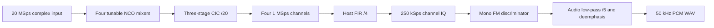

# RF observatory

Record one wideband bladeRF window, select up to four receiver channels, and
compare a fixed-point FPGA model with a floating-point reference. The first
application is mono broadcast-FM reception. The project includes synthesizable
VHDL for the channel bank, explicit hardware-to-host framing, and an integration
patch for each custom transport profile in the pinned bladeRF micro hosted
design.

The normal `capture` command uses the ordinary hosted image. Software reference
outputs and successful HDL simulation do not establish that custom gateware was
fitted, loaded, or tested on a board. Board synthesis and hardware qualification
are separate steps described in the [HDL guide](../hdl/README.md).

## Processing stages



Rust implements capture orchestration, file parsing, reference DSP and HDL
verification. VHDL describes the clocked FPGA datapath and integrates directly
with Nuand's existing VHDL design and Quartus flow. The upstream build system
retains its own languages. This hardware-description scope does not change the
workspace's Rust policy for host software.

## Build and check

Use the pinned workspace toolchain and initialize the upstream source checkouts:

```sh
git submodule update --init --recursive
cargo build --locked --release -p rf-observatory -p bladerf-lab
target/release/rf-observatory doctor
```

The Rust application does not link a native SDR library. Live acquisition
launches the separately built `bladerf-lab` radio adapter, which needs the
[native receive stack](../../../docs/SETUP.md). Saved-IQ processing and fixture
generation require no radio. HDL verification additionally needs **GHDL 6.0.0**
or a separately qualified compatible version. The tested host target is Linux;
process supervision and private file modes use Unix interfaces.

## Sweep a frequency range

Preview a sweep over a half-open range with integer hertz endpoints. The
planner accepts endpoints from 70 MHz through 6 GHz and reports the tuning
centers and raw IQ budget as JSON. `--plan-only` runs without the native
acquisition tool or a radio and creates no output directory.

```sh
target/release/rf-observatory sweep \
  --lower-hz 902000000 --upper-hz 928000000 --plan-only
```

Use the stock hosted image for live reception. Select the antenna-fed receive
connector with `--antenna 1` or `--antenna 2`. Build both tools from the same
checkout. The sweep uses the `capture-sweep` command in the RX-only
`bladerf-lab` adapter. Use `--receiver PATH` to select its executable and
`--gain` to set the manual gain in dB (default 40).

```sh
target/release/rf-observatory sweep \
  --lower-hz 902000000 --upper-hz 928000000 \
  --antenna 1 --output captures/observatory-sweep
```

The planner overlaps tunes so each center guard is covered by another usable
interval where needed. It uses the central ±8 MHz of each tune, excludes the
±100 kHz DC guard, and allows for tuning readback error. Choose endpoints
suited to the receive path in use. The adapter keeps one device open and uses a
fresh receive stream for each sequential dwell. There are gaps between dwells.
Each spectrum summarizes a bounded set of FFT windows that can be sparse. Use
independent decoder evidence to identify protocols.

The default dwell of 40 ms records 3,200,000 raw IQ bytes per tune. Adjust
`--dwell-ms` and check the plan against `--max-iq-bytes` (default 1 GiB).
Logs and reports use additional space. A live sweep creates a fresh directory,
writes `plan.json`, and checks available filesystem space before acquisition.
`acquisition-request.json` records the requested port, gain, and sample count.
`acquisition.log` contains the native output for the entire session. Each
completed tune directory, such as `tune-0001`, contains IQ, validated capture
metadata, and `spectrum.json`. A receiver error preserves completed captures
for validation and analysis. A lack of progress for the dwell duration plus
20 seconds requests receiver shutdown. An interruption preserves evidence
already on disk.
The terminal `sweep.json` is published after every planned tune has been
validated and the observed bands cover the request. If omitted, the output path
defaults under `captures/rf-observatory/`.

Use `--spectrum-output summary` to keep the same sparse window counts and
activity regions in `sweep.json` while omitting the detailed `spectrum.json`
files. Use `--spectrum-output skip` to finish after IQ length and metadata
validation. The receipt records the selected mode and omits spectrum window
counts and activity regions in `skip` mode. IQ and capture metadata remain
available for `triage-sweep`, `triage-series` and `identify-sweep`. The default
`full` mode writes the detailed spectrum at each tune.

The schema-1 plan lists the requested centers and detector geometry. The
schema-1 completion receipt lists the readback centers, observed frequency
bands, and activity regions at each tune. Compare activity against that tune's
own baseline. Overlapping tunes can report the same region separately. The
receipt reports elapsed times for native acquisition, including receiver
startup and shutdown, and for host spectrum analysis.

Use `capture_cadence` in `sweep.json` to compare nominal saved IQ time with
acquisition wall time. Current native adapters write `acquisition-timing.json`
with monotonic host offsets for each dwell. The terminal receipt binds its
SHA-256 and summarizes device setup, dwell phases, and spacing between host
read starts. Older adapters can supply IQ without these phase measurements.
Nominal IQ time comes from the saved sample count and rate. Host timings
describe work around each dwell and carry no first-sample hardware time.

Use [Digital Monitor](../../digital-monitor/docs/guide.md#identify-channels-in-a-saved-sweep)
to replay supported channels from a completed sweep and identify signals by
validated frame evidence.

### Verify sample continuity within dwells

Add `--check-continuity` to a sweep on Linux GNU with RX1 and FPGA version
0.16.0. Use the native receiver built from this checkout. Each dwell checks
device timestamps at 20 MSps and reads past the saved endpoint to verify its
last boundary. The IQ format and planned byte budget stay the same.

```sh
target/release/rf-observatory sweep --center-hz 907500000 --center-hz 922500000 \
  --dwell-ms 1000 --passes 2 --antenna 1 --check-continuity \
  --spectrum-output skip --output captures/observatory-checked
```

The terminal receipt requires valid timestamp evidence for every dwell.
A failed dwell leaves earlier completed captures available. The evidence uses
the device clock. It applies within each saved dwell, and `sweep-coverage`
reports the separate host read gaps between visits. The host read interval
includes the witness read.

### Revisit priority bands during a wide sweep

```sh
target/release/rf-observatory sweep --lower-hz 100000000 --upper-hz 500000000 \
  --dwell-ms 5 --priority-band 144375000:144405000:250 \
  --revisit-every 16 --plan-only
```

Repeat `--priority-band LOWER_HZ:UPPER_HZ[:MS]` to specify up to 32 bands.
Omit `MS` to use `--dwell-ms`. The planner packs compatible priority bands
into guarded tunings and inserts those visits before each group of at most
`--revisit-every` background visits. Priority bands can lie outside the
background range. The range retains its planned frequency coverage in each
pass. A shared center uses the longer dwell requirement.

The preview lists the full order in `visit_centers_hz` and charges every visit
against the IQ budget and the 500-visit limit per pass. Replacing `--plan-only`
with live capture options records that order. Shorter groups visit priority
bands more often and add acquisition time and IQ. Use `sweep-coverage` with
explicit band bounds and a minimum dwell to measure the resulting gaps.
For [Digital Monitor](../../digital-monitor/docs/guide.md#identify-channels-in-a-saved-sweep),
use `--channel-scope eligible` to consider channels outside the background
range and `--all-visits` to replay each eligible saved dwell. Pass `--series`
with the captures root to include every completed pass.

### Sweep selected bands

```sh
target/release/rf-observatory sweep \
  --band 906750000:907000000:6000 --band 908500000:909000000 \
  --dwell-ms 100 --plan-only
```

Repeat `--band LOWER_HZ:UPPER_HZ[:MS]` for up to 32 half-open bands. Omit `MS`
to use `--dwell-ms`. Each pass gives a band at least its requested time in
one dwell. The planner handles longer requests first and can share that dwell
with shorter requests. Repeated bounds use the longest requested duration.
Each complete band must fit on one side of a tune's center guard with room
for readback error. A band wider than 7,899,980 Hz is too wide for this mode.
Use `--lower-hz` and `--upper-hz` to survey a wider range across tunings.

Replace `--plan-only` with the antenna and output options to record the plan.
`plan.json` and each `sweep.json` record the requested bands separately from
the tuning centers. Band durations that differ from `--dwell-ms` appear in
`requested_band_dwells`. A pass receipt requires each band to meet its
coverage and duration at the observed center. Use `sweep-coverage` to measure
the saved listening time for those bands.

### Capture from a signal profile

Save decoder selections in a JSON file such as `signals.json`:

```json
{
  "schema_version": 1,
  "aprs_channel_hz": [144390000],
  "adsb": true,
  "ook_channel_hz": 433920000,
  "wh51_channel_hz": 915000000,
  "ws90_channel_hz": 915000000,
  "tpms_channel_hz": 315000000,
  "lte_range_hz": "744000000:758000000",
  "lte_pbch": true
}
```

```sh
target/release/rf-observatory sweep --signal-profile signals.json --plan-only
target/release/rf-observatory replay-sweep captures/signals \
  --signal-profile signals.json --share-iq --plan-only
```

Use replay option names with underscores. Repeatable selections
(`aprs_channel_hz`, `lora_profile`, `lora_packet_profile`, `nr_profile`, `nr_scs_khz`,
`rds_channel_hz`, `morse_profile`) are arrays. A profile selects the NR
raster with an explicit `nr_raster_hz` range and an RDS station grid with
`rds_raster_hz` in `LOWER:UPPER:STEP` form. The capture planner chooses
guarded tunings and raises dwell times to the selected decoders' minimum
input extents. Increase `--dwell-ms` for signals that repeat less often.
Capture and replay receipts record the profile file's SHA-256.
`ook_channel_hz` selects one channel for the supported OOK sensor formats.
The planner reserves at least 60 ms to fit a nominal Atlas frame with the
lightning extension. Use longer visits to observe periodic sensors.

Specify the antenna, gain, pass count and IQ budget on the sweep command
as needed. Replace `--plan-only` with `--antenna` and `--output` to capture.
The profile replaces the frequency selectors on `sweep` and
the analyzer selectors on `replay-sweep`. Profile paths are relative to
the invocation directory. Add `--series` when replaying a repeated sweep.

Add `--replay` to the sweep to run both stages in one command:

```sh
target/release/rf-observatory sweep --signal-profile signals.json \
  --replay --antenna 1 --output captures/signals
```

Preview with `--plan-only` to see capture bytes and the maximum decoder work
across accepted tuning readbacks. The same replay budget flags apply as on
`replay-sweep`. The command uses the loaded profile for both stages and
shares overlapping IQ reads during replay. The inline analyzers write
`replay.json` after the completed capture is published. A replay error
leaves that capture available for offline replay.

Use `lora_packet_profile` entries such as `"906875000:250000:11:43"`
to plan dwells for LoRa packet decoding. The planner allows room for the
acquisition symbols and explicit header. Set a longer `--dwell-ms` for
the full packets and listening time you need. With `--replay`, preview
reports packet attempts, source IQ reads, buffered IQ memory, and peak
temporary space.
`--lora-max-attempts` sets the worker attempt limit, and `--lora-worker`
selects the executable admitted before capture. After capture, the packet
decoder publishes the verified reports under `lora-packets/`. The other
selected analyzers then write `replay.json`.

### Repeat a sweep

Add `--passes N` to revisit the same centers on one open receiver. The series
uses the same ordered centers and dwell settings every pass, with a fresh
stream for each dwell. It accepts up to 16 passes and 2,000 total dwells.
`--plan-only` previews the aggregate IQ budget, which `--max-iq-bytes` limits.

```sh
target/release/rf-observatory sweep \
  --lower-hz 2400000000 --upper-hz 2483500000 --dwell-ms 40 \
  --passes 3 --antenna 1 --output captures/observatory-series
```

Each completed pass has its own `sweep.json` under `pass-0001`, `pass-0002`,
and so on. Point `triage-sweep` and `identify-sweep` at those directories.
The root `sweep-series.json` binds the pass receipts and shared timing file.
Its `same_center_revisit_ns` summarizes spacing between consecutive host reads
at each center, including priority visits within a pass. Per-pass acquisition
times run from the first tune to the last IQ publication. Per-pass elapsed time
adds that span and the pass's host analysis time. Receiver setup and close
are series costs.
A failed batch preserves closed IQ and earlier validated pass receipts. Pass
receipts include acquisition spans when shared timing validates. The series
receipt requires all passes and the shared timing to succeed.

### Measure listening time by band

```sh
target/release/rf-observatory sweep-coverage captures/observatory-series \
  --series --band 2401000000:2403000000 --band 2425500000:2427500000 \
  --min-dwell-ms 40 --output artifacts/listening-time.json
```

Provide up to 32 half-open frequency bands in `LOWER_HZ:UPPER_HZ` form. Set
the bounds to include the bandwidth and guard your decoder needs. For a sweep
planned with `--band`, omit the band arguments to measure those recorded in
the sweep. Omit `--series` for a single sweep or pass. A dwell contributes
when one usable span from its actual tuning contains the entire band. The
spans are within 8 MHz of the observed center and exclude the 100 kHz on
either side of it.
For example, a 20 MHz band has zero eligible dwells in this report even if
several adjacent tunings span it in aggregate.

The report counts covered dwells and passes and gives the total and longest
saved durations in nanoseconds. `--min-dwell-ms` selects the dwells counted
as qualifying, so short visits still appear in the coverage totals. Durations
use the validated sample counts at the nominal 20 MSps. If the receipt binds
native timing, `host_read_window` gives the first read start and last read end
as offsets from native session start. Each band reports leading, trailing and
longest gaps in that window for all covering reads and for qualifying reads.
With no reads in a selection, its longest gap is the entire window and the
leading and trailing fields are omitted. `longest_host_read_gap_ns` measures
the longest gap between covering reads. `sample_continuity_checked` appears
when the completed sweep carries validated device timestamps for every dwell.

Use `--frequency-map` in place of `--band` to measure a whole frequency
range, including regions with no covering dwells.

```sh
target/release/rf-observatory sweep-coverage captures/observatory-series \
  --series --frequency-map --min-dwell-ms 40 --output artifacts/coverage-map.json
```

The map defaults to the sweep's recorded contiguous range, including the
background range of a priority sweep. Pass `--range-hz LOWER:UPPER` for an
explicit half-open range in hertz. Targeted sweeps require this range.
`frequency_map` reports how many hertz had any covering or qualifying dwell
and provides the listening-time fields for each region. Region boundaries
come from the guarded spans of the actual readbacks. This measures coverage
at each frequency. A decoder needs its whole signal band in the same dwell,
and host-read gaps describe acquisition timing.

### Compare activity between passes

```sh
target/release/rf-observatory triage-series \
  --series-directory captures/observatory-series \
  --output-directory artifacts/observatory-series-triage
```

The report compares corresponding tuning centers across all passes using the
same bounded prefix of saved IQ. It groups observations on a common 100 kHz
grid and counts each pass once per cell. Mean-power rows track cells at least
6 dB above their frequency baseline. Narrow rows track short adjacent-contrast
bursts. Narrow rows retain the actual frequency and sample bounds of the
selected burst in each contributing dwell. Neighboring rows can share a
source interval. For a sequential sweep, a nominal cell at the edge of the
requested range can extend beyond that range.

By default at least two passes must support a band. Use `--min-passes` to
require more. `--max-bands` limits reported rows per detector, and detector and
report omissions are recorded. Narrow support comes from retained detector
candidates. `--max-samples-per-tune` and `--max-total-samples`
bound the scan. `series-triage.json` records each pass receipt hash, actual
tuning, and analyzed IQ prefix hash. Separate tuning centers remain separate
observations. The rows describe recurring power evidence within the sampled
windows. Protocol identity requires decoder evidence.

Add `--time-slices` to sample across each long dwell. Each pass still
contributes at most one vote per cell. The schema-2 series report uses the
same interval geometry and hashes as [distributed sweep triage](#distribute-analysis-across-a-dwell).
With [overlapping event windows](#overlap-event-windows), schema 3 records
the event stride for narrow witnesses.

Add `--max-activity-per-dwell 8` to write `activity.json` alongside
`series-triage.json`. It exposes one-off events and activity spread over
several cells using the same FFT windows and IQ reads. Each dwell keeps up
to the requested number (1–16) of transient events and mean-power regions,
ranked separately by peak excess over their detector baselines.

Transient rows give connected event bounds. Each mean-power row groups
neighboring cells and records the full analyzed interval used for the
average, which can include brief strong signals. Both use half-open bounds
in absolute hertz and original dwell samples. In a sequential sweep, retained
rows intersect the requested range. The report counts all transient candidates,
detector omissions, and eligible rows before the output cap. The sibling
report hash identifies the analyzed intervals and IQ digests. The command
writes relative power measurements without copying IQ.

### Capture selected centers

Pass a [Digital Monitor follow-up plan](../../digital-monitor/docs/guide.md#plan-a-sweep-follow-up)
to capture the requested center frequencies with one dwell per distinct center.
Add `--plan-only` to check the IQ budget before opening the receiver.

```sh
target/release/rf-observatory sweep --follow-up-plan artifacts/follow-up.json \
  --antenna 1 --output captures/observatory-follow-up
```

To choose the centers by hand, repeat `--center-hz HZ` in place of
`--follow-up-plan`. The `--dwell-ms` and `--max-iq-bytes` options apply to both
forms. Each planned tune must complete and pass readback validation. The
resulting schema-1 `sweep.json` uses operation `targeted_rf_sweep` and records
the requested and actual centers for each dwell. Its frequency bounds describe
the span of the requested centers, and its activity regions use each dwell's
observed sidebands. Gaps between tunes can remain. For an
imported plan, `plan.json` records both the source sweep receipt digest and
the follow-up plan digest.

With explicit centers, repeat `--dwell-at CENTER_HZ:MS` to give selected
channels a different listening time. Each override must name one of those
centers. The default and overrides support 1 through 10,000 ms. A repeated
sweep uses the same durations on every pass.

```sh
target/release/rf-observatory sweep --center-hz 909500000 --center-hz 1092000000 \
  --dwell-ms 100 --dwell-at 1092000000:3000 --passes 2 --plan-only
```

The preview charges the exact total IQ bytes across all passes. In a
completed sweep, a tune's `dwell_ms` takes precedence over the default
`dwell_ms` in the same receipt. `sweep-coverage` measures saved time from
each validated IQ extent. Longer dwells also increase the wait before the
receiver returns to other centers.

## Replay multiple protocols from a sweep

```sh
target/release/rf-observatory replay-sweep captures/observatory-series --series \
  --aprs-channel-hz 144390000 --adsb --lora-profile 906875000:250000:11 \
  --lte-range-hz 744000000:758000000 --rds-channel-hz 93300000 \
  --morse-profile nfm:147555000:750:20 --ook-channel-hz 433920000 \
  --output artifacts/replay.json
```

Select at least one analyzer and omit `--series` for a single completed
sweep or pass. The report binds each selected result to the same capture
receipt. Each section has the same coverage and evidence fields as its
standalone command. The LoRa section reports preamble candidates for
packet-decoding follow-up.

The analyzers use their standalone budgets by default. Use
`--max-samples-per-dwell` to select a prefix across analyzers. LTE and NR cap
this value at their standalone maxima. Each analyzer consumes its own selected
IQ prefixes. `--max-total-samples` applies independently to APRS, ADS-B,
AIS, DMR, DECT, HaLow, SCM, SCM+, OOK, Efergy, WH51, WS90, TPMS and RS41.
`--max-total-profile-samples` applies independently to LoRa and Morse.
LTE and NR each use the channelized sample budget. RDS uses its station
sample budget.
All selected analyzers check their budgets before any IQ payload reads.
A failed analysis leaves the requested report path unpublished.

The replay report marks capture sources with `sample_continuity_checked`
when every saved dwell carries validated device timestamps.

Replace `--output` and its path with `--plan-only` to print the validated
plan as JSON. It reports eligible and short attempts, the units each
analyzer charges, and the total IQ bytes scheduled for replay. The byte
count includes reads by multiple analyzers of the same dwell. Preview uses
receipt and file metadata and reads no IQ payloads.

Add `--share-iq` to replay in dwell order. AIS, DMR, DECT, HaLow, SCM, SCM+, OOK
and Efergy process a prefix longer than 40 MB together in 64 KiB blocks when
two or more of their routes request the same prefix. The dedicated sweep
commands for AIS, DMR, DECT, HaLow, SCM and SCM+ also use this path. Other routes
can share up to 40 MB of a dwell's prefix and read their remaining samples
separately. Decoder budgets and prefix digests apply individually. The
preview and report give the source bytes read and the maximum buffered IQ
in `shared_iq`.

## Triage a saved sweep

`triage-sweep` reads a completed sequential or targeted sweep offline on
Linux with GNU libc. Run it from the workspace root and choose a fresh output
path.

```sh
target/release/rf-observatory triage-sweep \
  --sweep-directory captures/observatory-sweep \
  --output-directory artifacts/observatory-triage
```

The detector compares 100 kHz cells with their median power within each dwell
and groups neighboring hits at least 6 dB above that baseline. It uses the
inner ±8 MHz around the readback center, excluding the ±100 kHz center guard.
Sequential sweeps retain events that intersect the requested frequency range.
Targeted sweeps use both observed sidebands of each tune. The event search
favors transients and can miss activity present throughout a dwell.
At least three complete FFT windows are needed for a cell to cross the
threshold.

Analysis defaults to the first four million samples (200 ms) per tune and a
200 million-sample budget across the sweep. `--max-samples-per-tune` and
`--max-total-samples` can reduce these limits. Each tune receives an equal share
of the total budget and analysis ends at the last complete FFT window within
its limit. The report gives the analyzed extent and prefix digest per tune.

The default budget is eight clips. Connected events rank by peak excess over
each tune's baseline. Up to two slots go to a separate search for 100–400 kHz
bursts lasting two to ten FFT windows. The mean excess must reach 6 dB in
the target band and exceed each adjacent band's mean excess by at least 3 dB.
Candidates rank by the smaller of those two contrasts. This search can find
a narrow burst inside a wide event. Within a dwell, nearby narrow passes
with substantial overlap in frequency and time share a slot.

Use `--max-clips` to set the total limit from 1 to 32. `--narrow-clips` sets
the number of narrow slots within that limit, leaving at least one slot for
connected events. Unused slots go back to connected events. Set
`--narrow-clips 0` to use peak ranking alone.

Each clip preserves the original 20 MSps IQ at the tune's readback center.
A clip holds up to 245,760 samples (12.288 ms) including filter context.
Longer events are cropped around their strongest window. Each clip comes with
an SC16 Q11 sidecar for offline analysis. Schema 2 `triage.json` records the
detector, original event bounds, clip offsets, and hashes of the receipt,
acquisition sidecars, analyzed IQ prefixes, and clips.

Narrow events with enough filter context and separation from the tune center
also get phase-order and frequency-plateau measurements. The filter can include
nearby activity, so the hints apply to the measured passband. Frame validation
requires a decoder. A sweep gives distinct observations at each tune, with
time gaps between dwells.

### Distribute analysis across a dwell

Add `--time-slices 4` to spread the same sample budget over the dwell.
The default analyzes one prefix. A distributed scan uses evenly spaced
slices of complete FFT windows, including both ends when it can use more
than one slice. A fully covered dwell uses one contiguous interval. The
budget and available sample count can reduce the number of slices.

Each slice has its own detector baseline. Events and exported clips stay
within one analyzed interval, and the gaps are unexamined. Schema 3
records the original sample ranges and SHA-256 of each interval. Follow-up
planning validates that every candidate lies inside its recorded interval.

### Overlap event windows

Add `--overlap-events` to `triage-sweep` or `triage-series` to step
8,192-sample event windows by 4,096 samples. The extra windows can reveal
short bursts near FFT boundaries. An interval of `n` complete windows uses
`2n - 1` FFTs with overlap and keeps the same sample budget and digest.
The mean-power summary still uses nonoverlapping windows.

The two-to-ten-window narrow rule spans fewer samples with overlap, so
different bursts can qualify. The intermediate windows can also change
which connected events rank highest. The single-sweep schema-4 report
records the stride. Follow-up planning accepts either stride and checks
the recorded sample bounds.

Use `triage-series --both-event-strides` to keep both results from one
IQ read and FFT pass. It writes `series-triage.json` for the contiguous
stride and `series-triage-overlap.json` for the half-window stride.
`--max-activity-per-dwell` also writes `activity.json` and
`activity-overlap.json`. Each stride retains its own ranking and report
limits. Either recurrence report can drive a follow-up sweep.

### Revisit narrow candidates

Pass a `triage.json` receipt to `sweep` to revisit its measured narrow clips.
Preview the exact tuning centers and raw IQ budget before recording.

```sh
target/release/rf-observatory sweep --triage-report artifacts/observatory-triage/triage.json \
  --dwell-ms 200 --plan-only
```

For each candidate, the planner prefers centers 2 MHz below and above its
band midpoint. Both dwells keep the complete candidate band in a usable
sideband for the allowed readback error. Centers differ by at least 500 kHz
from each other and from the source readback. Near tuning limits, a pair may
use the same side. Candidates can reuse centers. The plan lists which clips
fit and rejects an empty plan or one above `--max-iq-bytes`.

Replace `--plan-only` with `--antenna 1 --output captures/triage-follow-up`
when RX1 carries the intended feed. `plan.json` maps clips to the requested
centers and preserves the triage and original sweep digests. The terminal
receipt records the observed centers and links to both source digests.
Compare activity at the same absolute RF frequency in the new dwells.
Band midpoints come from the detector grid and decoder evidence establishes
protocol identity.

### Revisit recurring bands

```sh
target/release/rf-observatory sweep \
  --series-triage-report artifacts/observatory-series-triage/series-triage.json \
  --dwell-ms 100 --passes 2 --plan-only
```

The planner uses the recurring narrow rows and covers their nominal cells
and recorded readback shifts. It pairs offset centers where possible and
reuses a dwell when the same centers cover multiple rows. The preview links
each pair to its original row, lists rows that could not be placed, and
shows the aggregate IQ budget. The plan and capture receipts carry the
report hash and its recorded source series hash.

To revisit both strides in one sweep, supply the contiguous report with
`--series-triage-report` and the matching half-window report with
`--overlap-series-triage-report`. Both must describe the same captured
series. Exact matches in the same source tune share a target and count
each supporting pass once. Targets can also share eligible offset dwells.
The plan records both report hashes and keeps the row references.

Paired source row numbers list the primary rows first and then the overlap
rows. The plan gives the primary row count and `overlap_source_row` keeps
the original row number from the second report.

Use the receive connector carrying the intended feed when running the plan
without `--plan-only`. Compare each band's evidence at both offsets and
across passes to check whether activity returns at the same RF frequency.

### Revisit selected activity

To revisit a one-off transient or mean-power region, use the activity report,
its exact companion triage report, and the completed source series.

```sh
target/release/rf-observatory sweep \
  --series-triage-report artifacts/observatory-series-triage/series-triage.json \
  --series-activity-report artifacts/observatory-series-triage/activity.json \
  --series-activity-source captures/observatory-series \
  --activity-target 1:2:transient:1 --dwell-ms 100 --passes 2 --plan-only
```

Select up to 32 rows. The pass, tune and row in `PASS:TUNE:KIND:ROW` start
at 1. Use `transient` or `mean-power` for the array to index. Match the
overlap activity report with its overlap triage report when using that
stride. Preview checks each selected analyzed IQ interval once and records
its digest. Every selected band must fit at both offset centers. The plan
and capture receipts carry all three source digests.

Replace `--plan-only` with the receive connector and an output directory to
record the new dwells. Compare those dwells with `triage-series` or
`triage-sweep`. The selected rows describe observed power and timing.

### Check saved follow-up dwells

```sh
target/release/rf-observatory analyze-follow-up \
  --capture-directory captures/observatory-follow-up \
  --series-triage-report artifacts/observatory-series-triage/series-triage.json \
  --output-directory artifacts/observatory-follow-up-analysis
```

Use the original triage report and the completed capture directory, including
its saved plan. For a paired capture, supply the same
`--overlap-series-triage-report` here. The command checks the plan and capture
lineage before reading IQ. It measures a fixed band alongside its lower and
upper flanks, the source band shifted to the same offset from the current
tuning center, and the mirror band. Targets sharing a dwell use the same FFT
pass, including overlapping controls.

An isolated run requires at least two consecutive 1,024-sample target
windows at least 6 dB above their median baseline, with all four controls
below their own thresholds throughout the run. The report marks unavailable
controls and records exact run offsets and analyzed IQ prefix hashes. Adjust
`--max-total-samples` and `--max-samples-per-dwell` to bound the inspected
prefixes. Isolation describes relative power in the recorded windows.

Add `--waveform-probes 32` to measure phase symmetry and binary FSK evidence
in up to 32 eligible runs. The command starts with one run per target and
prefers longer runs within each observation. A measurement needs at least
8,192 input samples and 400 context samples on each side within the analyzed
prefix. Long runs are measured around their midpoint within the clip limit.
Each probe records the original and measured sample ranges, the range and
SHA-256 of the IQ used including filter context, and the waveform evidence.
The report counts skips and records how many eligible runs exceeded the probe
limit. Measurements read the existing IQ and can abstain on modulation.

## Record and inspect a wideband window

```sh
target/release/rf-observatory capture --center-mhz 98 --duration 0.5 --antenna 1 --gain 40 --output captures/observatory
target/release/rf-observatory survey captures/observatory/wideband.sc16q11 --center-mhz 98 --output artifacts/observatory-spectrum
```

Select the receive connector carrying the intended feed. Acquisition uses
20,000,000 complex samples/s and little-endian, interleaved SC16 Q11. Each sample
occupies four bytes; one second is 80,000,000 bytes. Duration is bounded to ten
seconds and must provide at least 8,192 samples for spectrum analysis.

The acquisition sidecar retains actual tuning, rate, bandwidth, gain and start
time. The wrapper validates sample representation, settings and completed byte
length. RF tuning readback can differ slightly because of synthesizer
quantization; the wrapper accepts up to 10 Hz while retaining the readback.
The automatic capture spectrum uses that actual center. When replaying files,
supply their known center explicitly rather than inferring it from a filename.

`spectrum.json` contains an averaged Hann-window spectrum, energy-ranked
candidate centers and `activity_detection`. It is schema version 1 with
operation `offline_rf_spectrum_survey`, allowing consumers to reject an
incompatible producer contract before interpreting its numeric fields. Each FFT
window has its Hann-weighted complex mean removed before analysis. Candidate scoring excludes
every ±80 kHz integration that overlaps the ±100 kHz center guard, where a
zero-IF receiver artifact and the deliberate DC removal make signal inference
unsafe. Use an offset follow-up tuning to investigate that guard rather than
treating it as empty. `survey` also writes the DC-removed bins to
`spectrum.csv`.

Activity detection divides the central ±8 MHz into 160 half-open 100 kHz cells.
It triggers a cell when its average is at least 6 dB above the lower-quartile
frequency baseline or a sampled window is at least 6 dB above that cell's
temporal median, then merges adjacent triggers into
`unclassified_spectral_activity` regions. Cell powers are normalized by their
FFT-bin counts. These relative heuristics can be triggered by analog or digital
signals, noise, interference or receiver artifacts; they do not establish a
protocol identity, calibrated power or an occupied channel.
`strongest_trigger_cell_frequency_hz` is the center of the cell maximizing the
larger of its mean frequency-baseline excess and peak temporal-median excess;
it is not necessarily a carrier or the maximum-power cell.

The spectrum uses bounded windows distributed over a bounded input prefix.
When the inspected prefix is long enough to supply the requested count, one
8,192-sample window represents 0.4096 ms at 20 MSps, the default 128 windows
inspect 52.4288 ms in total and the maximum 512 inspect 209.7152 ms. A shorter
prefix clamps the actual count to the number of complete nonoverlapping windows;
the report retains the actual count and sampled duration. Its sampled-window hit
fraction is incidence within those sparse windows, not RF occupancy or continuous
monitoring. Candidate centers remain 100 kHz-grid suggestions, not confirmed
stations.

For short transients, use `survey --dense` to inspect consecutive complete
FFT windows in the selected file prefix, up to 200 million complex samples
with `--max-samples`. It uses the same activity gates and conflicts with
`--windows`. The dense `spectrum.json` reports its stride, analyzed samples
and omitted tail. Hit fractions still describe the inspected file windows.

Add `--events` to a dense survey to write `events.json`. It bounds connected
6 dB temporal power hits by saved-sample index and frequency at the supplied
center. SHA-256 covers the analyzed prefix, four little-endian bytes per
SC16 Q11 I/Q pair. The report keeps up to 4,096 components ranked by peak
excess and counts omissions. Bounds may enclose tiles without hits.
With `--include-band-edges`, the event grid covers the nominal 20 MHz
sampled band with the same center guard. The spectrum summary still uses its
inner activity grid. Edge events describe relative power in saved IQ.
Use `--overlap-events` for a half-window stride (schema 2).
Use `--active-window-ranges` with either stride to write a schema 3 report.
Its slices cover all windows with a hit, including those outside retained
components. Padding, merging and export limits apply to both selections.
Short components up to 400 kHz wide and two through ten windows long can
also report `narrow_contrast_db`. It averages the per-window difference
between the target and its stronger equal-width neighbor. Each cell's
excess is relative to its temporal median. Both neighbors must lie inside
the survey grid and outside the center guard.
Schema 3 also reports up to 128 candidates in `narrow_search` and counts
all qualifying runs. It searches fixed bands one to four cells wide for
two to ten consecutive windows with at least 6 dB of temporal excess and
3 dB of contrast. This can surface a burst inside a wider component.

`slice-events capture.sc16q11 --events events.json --output slices` accepts
captures up to 200 million samples. It checks capture metadata and verifies
the analyzed bytes against the event report's prefix digest.
It writes full-band IQ and replay sidecars for padded, ten-sample-aligned
ranges. Set context with `--pre-roll-samples` and `--post-roll-samples`.
`--merge-gap-samples` joins ranges across gaps up to that size (default zero).
`--coalesce-to-limit` also joins the smallest remaining gaps until the plan
meets `--max-slices`.
Gap samples count toward `--max-total-samples`. That limit and `--max-slices`
apply after merging, before publication.
`slices.json` records source offsets, omitted events and the clipped alignment
tail. The complete private directory is published together without replacement.

Use `probe-waveform` on a saved 20 MSps clip to inspect phase-order and
binary-FSK-like evidence. Supply the clip-local interval, tuning in hertz and
target band center. The interval needs 400 samples of saved context on each
side. The report binds the clip SHA-256 and records spectral-line and
frequency-plateau measurements. Hints describe candidate modulation only.
Supply `--modulation` and `--symbol-rate-hz` to request unframed BPSK, QPSK
or binary FSK symbols. The report requires consistent transitions at the
supplied rate and leaves constellation rotation or bit polarity unresolved.
Use `--search-symbol-rate` to estimate rates from 8 to 200 ksym/s. An
optional `--modulation` restricts the search. Ambiguous or weak clock
evidence yields a report without symbol decisions. Repeated data can
support a lower observable rate.

Use `probe-bursts` with the saved IQ's `--center-hz` and band bounds
`--lower-hz` and `--upper-hz`. It reads up to 20 million samples and reports
power burst intervals on a 51.2 µs grid. Supply `--baseline-samples` for a
quiet prefix or omit it to use the median power of the complete windows.
Repeat `--also-band-hz LOWER:UPPER` for up to seven disjoint companion bands.
The schema 2 receipt gives each band its own threshold bitmap. The first search
window occupies the low bit of the first hex-encoded byte.

Use `probe-ofdm INPUT --start-sample FIRST --end-sample END --output REPORT`
on original-rate 20 MSps IQ. It checks eight-symbol runs for coherent
cyclic prefixes at a 64-sample useful interval and prefix lengths of 8 or 16.
Use `--useful-samples 256` to test prefix lengths of 16, 32 or 64 over
an interval of at least 2,752 samples.
The report binds the clip SHA-256 and records a qualified geometry or an
abstention. A qualified result describes waveform structure and timing.

The native tool can also produce a conventional PSD plot from the IQ sidecar:

```sh
target/release/bladerf-lab analyze captures/observatory/wideband.sc16q11 --output artifacts/observatory-psd.png
```

## Decode APRS packet radio

`identify-aprs` replays a single 1,200-baud Bell 202 channel from saved
little-endian SC16 Q11 IQ. It accepts 20 MSps sweep dwells and 2 MSps targeted
captures. Use the actual capture center and sample rate from the native
sidecar. Offset the tuning from the channel to avoid receiver DC. Keep the
channel and 12 kHz of margin inside the central 80% of the sampled band. Use
the APRS frequency for your region. The example uses 144.390 MHz, commonly
used in the US and Canada.

```sh
target/release/bladerf-lab capture --frequency 143890000 --sample-rate 2000000 \
  --channel 1 --duration 30 --output captures/aprs.sc16q11
target/release/rf-observatory identify-aprs captures/aprs.sc16q11 \
  --center-hz 143890000 --channel-hz 144390000 --sample-rate-hz 2000000 \
  --output artifacts/aprs.json
```

Select the connector carrying the intended receive feed. Ensure the report's
parent directory exists. The decoder checks HDLC framing and FCS and retains
AX.25 UI frames with the control and PID used by APRS. The JSON report keeps
addresses, frame and information bytes, printable text when available, and
the input sample where each frame decision was made. That index includes
receiver filter and decoder delay. Identical decodes from parallel timing
hypotheses count once per occurrence. The report hashes every analyzed input
byte. `--max-samples` limits the prefix, with a file limit of 200 million
samples. Zero frames means that no frame passed validation in the analyzed
extent. The [APRS protocol reference](https://www.aprs.org/doc/APRS101.PDF)
describes the application formats carried in the packet information field.

### Replay APRS from a sweep

```sh
target/release/rf-observatory identify-aprs-sweep captures/observatory-series \
  --series --channel-hz 144390000 --output artifacts/aprs-sweep.json
```

Pass the completed capture directory. Use `--series` for a repeated sweep,
and repeat `--channel-hz` for up to 32 distinct frequencies. For each channel,
the command replays every saved dwell whose actual tuning covers it. Each
dwell starts with independent decoder state. Use offset tunings to reduce
interference from receiver DC.

The report distinguishes absent RF coverage, covered prefixes shorter than
the nominal 140 ms minimum frame duration, and completed decoder attempts.
Each attempt binds the pass receipt, sidecar and analyzed IQ bytes. Use
`--max-samples-per-dwell` to limit each prefix and `--max-total-samples` to
bound the planned work across all channels and dwells. The default total is
200 million samples. A plan that exceeds the limit fails before decoding.
Use longer dwells for intermittent packet traffic.

## Decode Morse on one RF channel

```sh
target/release/rf-observatory identify-morse captures/cw.sc16q11 \
  --center-hz 147105000 --channel-hz 147555000 --sample-rate-hz 2000000 \
  --mode cw --wpm 20 --output artifacts/morse.json
```

Use the actual center and rate from the capture sidecar. The command accepts
2 or 20 MSps SC16 Q11 IQ. In `cw` mode, select the frequency of the keyed
carrier. For a keyed tone on narrowband FM, select `--mode nfm` and use
`--tone-hz` to set the audio tone (750 Hz by default).

Supply a known character speed from 8 to 40 WPM or omit `--wpm` to estimate
it. The decoder uses standard International Morse spacing. The report retains
up to 512 character records, with positions on the 1 kHz power-envelope grid
and raw patterns for unresolved characters. The selected frequency and
plausible timing are the evidence for the transcription. See
[ITU-R M.1677-1](https://www.itu.int/rec/R-REC-M.1677-1-200910-I/).

`--max-samples` selects the original-rate prefix. The report binds its
SHA-256 and writes to a new private file. Envelope positions include receiver
filter delay.

### Identify AIS stations

```sh
target/release/rf-observatory identify-ais-sweep captures/marine \
  --channel-hz 161975000 --channel-hz 162025000 --output artifacts/ais.json
```

AIS replay validates the frame check after GMSK, NRZI and bit-stuff decoding.
It also uses the GMSK training sequence to align a phase-tracking decoder
for weak bursts. Both decoding paths require the same frame check.
Reports for message types 1–28 preserve the nine-digit source MMSI, message
type, repeat indicator and approximate sample bounds. Type 18 also reports
the Class B unit kind. Type 24 reports the part and available equipment
fields from Part B. [ITU-R M.1371-6, Annexes 2 and 7][ais-spec]

Set `"ais_channel_hz": [161975000, 162025000]` in a signal profile to plan
both VHF channels together. The 60 ms planning floor fits two nominal slots.
Use longer listening windows to observe periodic traffic. The dedicated sweep
command and `replay-sweep --share-iq` read a common dwell prefix once and
charge decoder work for each covered channel.
[U.S. VHF channels][ais-channels]

Use `identify-ais FILE --center-hz HZ --channel-hz HZ --output REPORT` for
one saved Q11 channel. Add `--sample-rate-hz 96000` for narrow IQ. At 20 MSps,
the channel must fit in one guarded receive span.

[ais-spec]: https://www.itu.int/epublications/fr/publication/recommendation-itu-r-m-1371-6-02-2026-technical-characteristics-for-vhf-automatic-identification-system-using-time-division-multiple-access-in-the-maritime-mobile-se/en
[ais-channels]: https://navcen.uscg.gov/us-vhf-channel-information

### Identify 433 MHz OOK sensors

```sh
target/release/rf-observatory identify-ook-sweep captures/observatory-series \
  --series --channel-hz 433920000 --output artifacts/ook-sensors.json
```

OOK replay identifies AcuRite Iris, Tower and Atlas, La Crosse TX141TH-Bv2,
Oregon Scientific THGR122N and WGR800-family sensors, and Govee
H5054-compatible leak sensors. The detectors share one IQ read. Frame checks
reject corrupt copies. Repeated copies within one transmission contribute
to one observation.
Each dwell starts fresh and reports its source and IQ digests.
`--max-total-samples` bounds replay before sample reads, and
`--max-transmissions` caps retained details while preserving totals.
Reports count pulse trains skipped after the 1,024-pulse burst limit.
Tower and Atlas share the peak-tracking envelope with Oregon. Its skipped
burst count uses the Oregon field when that detector is enabled and the
AcuRite field for shorter captures.

Use `identify-ook FILE --center-hz HZ --output REPORT` for a single saved Q11
file and supply `--sample-rate-hz` for rates other than 20 MSps. Centered
250 or 500 kSps inputs are already channelized. Wideband inputs must place the
whole channel on one side of the DC guard. Sample positions are envelope
edges adjusted by the nominal filter delay. Frequency identifies the selected
channel. AcuRite channel values `0`, `1`, and `2` correspond to A, B, and C.
Tower reports a 14-bit sensor ID and groups matching copies across short
gaps. Atlas reports a 10-bit sensor ID,
`message_type`, and the copy sequence mask. Atlas can identify all three
message types with or without the lightning extension.
`identifier_scope` distinguishes AcuRite protocol IDs from La Crosse and
Oregon power-cycle session codes. Oregon reports the encoded channel and uses
observed sync and body edges for sample bounds. WGR800 reports its numeric
`sensor_type`.
Translated Oregon IQ uses an interpolated oscillator and a nominal
220 kHz cutoff when that width fits the guarded span.
[Iris frame reference][ook-acurite] · [Tower frame reference][ook-tower] ·
[Atlas frame reference][ook-atlas] · [La Crosse frame reference][ook-lacrosse]

Set `"ook_oregon_scientific": true` alongside `"ook_channel_hz": 433920000`
in a signal profile to reserve a guarded ±220 kHz channel and at least
400 ms per visit. The longer dwell fits a nominal WGR800 repeat train.
For periodic discovery, the AcuRite 06002M sends every 16 seconds. The Atlas
updates wind speed every 10 seconds and most other readings every 30 seconds.
The THGR122N reports about every 40 seconds and the WGR800X about every 14 seconds.
[Tower specifications][ook-tower-spec] · [Atlas specifications][ook-atlas-spec] ·
[Oregon frame reference][ook-oregon]
[THGR122N manual][ook-thgr122n] [WGR800X manual][ook-wgr800x]

Saved OOK replay includes Govee automatically. Its rows include a protocol
sensor ID, integrity check, event, and raw event code and data. A CRC frame
with an all-ones ID reports `id: null` and `identifier_scope: "unattributed"`.
The legacy format requires three matching parity-checked copies. Interference
that obscures pulse timing can split a group.
Set `"ook_govee_h5054": true` with `"ook_channel_hz": 433920000` to plan
at least 250 ms per visit. Use a longer dwell for a timed button or wet
test. [H5054 CRC frames][ook-govee-crc] [H5054 legacy frames][ook-govee-legacy]

[ook-acurite]: https://github.com/merbanan/rtl_433/blob/39542a090627861a649718f1ed302b4573120311/src/devices/acurite.c#L544-L619
[ook-tower]: https://github.com/merbanan/rtl_433/blob/39542a090627861a649718f1ed302b4573120311/src/devices/acurite.c#L837-L923
[ook-atlas]: https://github.com/merbanan/rtl_433/blob/39542a090627861a649718f1ed302b4573120311/src/devices/acurite.c#L643-L817
[ook-tower-spec]: https://www.acurite.com/products/indoor-outdoor-temperature-humidity-sensor
[ook-atlas-spec]: https://www.acurite.com/products/acurite-atlas-weather-sensor
[ook-lacrosse]: https://github.com/merbanan/rtl_433/blob/39542a090627861a649718f1ed302b4573120311/src/devices/lacrosse_tx141x.c#L26-L58
[ook-oregon]: https://www.osengr.org/Articles/OS-RF-Protocols-IV.pdf#page=28
[ook-thgr122n]: https://asset.conrad.com/media10/add/160267/c1/-/gl/000646461ML02/mode-demploi-646461-capteur-thermohygrometrique-oregon-scientific-6937.pdf#page=1
[ook-wgr800x]: https://fccid.io/m/213f062da6b16efa9dcefe76fa047e7fdc16b86e3b45573adde9df0560ffeaa1.pdf#page=4
[ook-govee-crc]: https://github.com/merbanan/rtl_433/issues/2265#issuecomment-1345377273
[ook-govee-legacy]: https://github.com/merbanan/rtl_433/issues/1518#issuecomment-770428323

### Identify Efergy e2 transmitters

```sh
target/release/rf-observatory identify-efergy-sweep captures/household \
  --channel-hz 433550000 --output artifacts/efergy.json
```

Replay identifies the 16-bit transmitter field in checksum-validated e2
Classic FSK frames. Reports include the encoded interval, battery and learning
flags, raw current mantissa and signed exponent, and original sample positions.
The [e2 Classic guide, printed p. 10][efergy-manual] specifies 433.5 MHz and
10 seconds for E2-3.0. The [measured framing reference][efergy-framing] places
its capture near 433.55 MHz. Use the estimate for your transmitter and allow
listening time over several expected periods.

Use `identify-efergy FILE --center-hz HZ --output REPORT` for one Q11 file.
Set the actual sample rate for 250 or 500 kSps, or 1 or 2 MSps input. For
20 MSps IQ, the ±90 kHz receive band must fit on one side of the DC guard.
Set `"efergy_channel_hz": 433550000` in a signal profile to plan guarded
capture and include Efergy in replay. The 25 ms planning minimum fits frame
timing. Efergy and 433.92 MHz OOK sensors can share a dwell.

[efergy-manual]: https://efergy.com/wp-content/uploads/2019/06/Efergy_E2_Installation_Guide.pdf#page=2
[efergy-framing]: https://github.com/merbanan/rtl_433/blob/39542a090627861a649718f1ed302b4573120311/src/devices/efergy_e2_classic.c#L10-L94

### Identify WH51 FSK sensors

```sh
target/release/rf-observatory identify-wh51-sweep captures/observatory-series \
  --series --channel-hz 915000000 --output artifacts/wh51-sensors.json
```

The decoder uses the alternating WH51 preamble to recover symbol timing
and the two tone levels. A frame must match the family byte, CRC-8 and
byte sum. Reports carry the 24-bit sensor ID and approximate sync-to-end
sample bounds. Complete repeat frames retain their own sample positions.
`--max-frames` caps detail while preserving the validated frame count.
[WH51 frame reference][wh51-frame] describes the supported format.

Set `wh51_channel_hz` in a signal profile to plan guarded dwells and include
WH51 in combined replay. The planner reserves at least 12 ms for framing.
Use repeated or longer visits for sensors with sparse reporting. For one
saved Q11 file, run `identify-wh51 FILE --center-hz HZ --output REPORT`.
Set `--sample-rate-hz` for 1 or 2 MSps input. At 20 MSps the whole sensor
channel must fit in one guarded receive span.

[wh51-frame]: https://github.com/merbanan/rtl_433/blob/39542a090627861a649718f1ed302b4573120311/src/devices/fineoffset.c#L637-L715

### Identify WS90 FSK weather stations

```sh
target/release/rf-observatory identify-ws90-sweep captures/weather \
  --channel-hz 915000000 --output artifacts/ws90.json
```

WS90 replay checks the sync, family byte, CRC-8 and byte sum of each
32-byte body. Reports include the transmitted 24-bit sensor ID, firmware
byte, battery millivolts, temperature in tenths of a degree Celsius and
the humidity byte as a percentage. Unavailable measurements are `null`.
Approximate original sample bounds
start at the two preamble bytes included in sync. Separate complete
retransmissions count independently. `--max-frames` limits retained details.

Use `identify-ws90 FILE --center-hz HZ --output REPORT` for a single Q11
file. Supply `--sample-rate-hz` for 1 or 2 MSps captures. For 20 MSps, the
whole sensor channel must fit in one guarded receive span. Use
`replay-sweep --ws90-channel-hz HZ` for combined replay or set
`ws90_channel_hz` in a signal profile. A profile can cover WS90 and WH51
in the same guarded dwell. The WS90 planning minimum of 20 ms covers
framing. Give periodic sensors longer coverage. The classic WS90 manual
specifies an 8.8-second reporting interval. [Ecowitt specifications][ws90-manual]
[WS90 frame reference][ws90-frame]

[ws90-manual]: https://oss.ecowitt.net/uploads/20241106/WS90%20Manual.pdf#page=13
[ws90-frame]: https://github.com/merbanan/rtl_433/blob/39542a090627861a649718f1ed302b4573120311/src/devices/fineoffset_ws90.c#L66-L137

### Identify Pacific TPMS sensors

```sh
target/release/rf-observatory identify-tpms-sweep captures/observatory-series \
  --series --channel-hz 315000000 --output artifacts/tpms-sensors.json
```

The decoder checks differential Manchester framing, CRC-8 and complementary
pressure bytes. The `pmv_107j` model reports a 28-bit sensor ID and pressure
in pascals. The `pmv_c210` model reports a 32-bit ID and pressure in
quarter-PSI units. Both report whole degrees Celsius. Records identify the
sensor field within its model and include approximate sync-to-end sample
bounds. `--max-frames` caps details while preserving the validated counts.
Separate retransmissions count as separate frame occurrences.

The default channel is 315 MHz. Select `--channel-hz 433920000` for a
433.92 MHz capture. For a single saved Q11 file, run
`identify-tpms FILE --center-hz HZ --output REPORT` and supply the actual
`--sample-rate-hz` for 250 kSps, 500 kSps, 1 MSps or 2 MSps input.
Set `tpms_channel_hz` in a signal profile to plan guarded dwells and replay.
The 16 ms planning minimum covers framing. Increase listening time for
sensors that report infrequently.

[PMV-107J framing](https://github.com/merbanan/rtl_433/blob/39542a090627861a649718f1ed302b4573120311/src/devices/tpms_pmv107j.c)
and [PMV-C210 framing](https://github.com/merbanan/rtl_433/blob/39542a090627861a649718f1ed302b4573120311/src/devices/tpms_toyota.c)
describe the supported wire formats.

### Identify Vaisala RS41 radiosondes

```sh
target/release/rf-observatory identify-rs41-sweep captures/observatory-series \
  --series --channel-hz 402500000 --output artifacts/rs41.json
```

Use the actual carrier for the sounding. The RS41-SG uses 4,800 bit/s GFSK
in the 400.15–406 MHz band. The decoder looks for synchronization at either
polarity, dewhitens standard and extended frames, and checks both interleaved
Reed–Solomon words and the STATUS CRC. It reports the STATUS `serial`,
`frame_number`, byte corrections, and nominal frame sample bounds adjusted
for filter delay. `--max-frames` limits retained details.

For one saved Q11 file use `identify-rs41 FILE --center-hz HZ --channel-hz HZ`
with `--output REPORT`. Set `--sample-rate-hz 96000` for narrow IQ. The default
20 MSps input places the whole selected channel outside the center guard.
Use `replay-sweep --rs41-channel-hz HZ` for combined replay or set
`rs41_channel_hz` in a signal profile. Profile-driven capture reserves
900 ms for frame duration. Longer dwells provide more overlap with the
one-second measurement cycle. [Vaisala RS41-SG datasheet, p. 2](https://docs.vaisala.com/api/khub/documents/LD~wzzCT3_XBTpdY2K~jJw/content#page=2)
[Published RS41 frame analysis](https://github.com/rs1729/RS/blob/ce448555d34da5ca01f1a526e838c4f7be464481/rs41/rs41.txt#L198-L290)

#### Search the RS41 band in a saved sweep

```sh
target/release/rf-observatory identify-rs41-raster-sweep captures/weather \
  --plan-only
target/release/rf-observatory identify-rs41-raster-sweep captures/weather \
  --output artifacts/weather-raster.json
```

The command searches the **469 centers** on the 12.5 kHz grid from
400.15 to 406 MHz. It independently checks each eligible channel for RS41
sync and frame integrity. A shared filter bank reads each selected 20 MSps
dwell once and translates the covered channels to 50 kSps. Use `--series`
for a sweep series, or set `--lower-hz` and `--upper-hz` to aligned inclusive
limits for a smaller search.

The plan reports covered, short, and replayed channels and charges channel
samples before replay. Set `--max-channelized-samples` and
`--max-samples-per-dwell` to bound work. A frame seen by overlapping filters
is merged when the serial, frame number, start time, and carrier estimates
agree. The report preserves the individual channel counts and the selected
frame's estimated carrier frequency.

Set `"rs41_raster_hz": "400150000:406000000"` in a
[signal profile](#capture-from-a-signal-profile) to plan guarded visits and
decode with `sweep --signal-profile PROFILE --replay`. Each covering visit
is at least 900 ms. The profile checks source and channelized sample
budgets independently. Replay a saved sweep with that profile or with
`replay-sweep --rs41-raster-hz LOWER:UPPER`.

### Identify DMR voice link control

```sh
target/release/rf-observatory identify-dmr-sweep captures/radio \
  --channel-hz 444000000 --channel-hz 444012500 --output artifacts/dmr.json
```

Use the participating radio's configured channel centers. Replay accepts
unprotected standard group and individual voice link control headers and
terminators after Slot Type, product-code, and Reed–Solomon checks. Reports
include the configured 24-bit source and destination, destination kind,
color code, sync context, and nominal burst sample bounds. Direct-mode
sync can identify a slot explicitly. Base-station and mobile-station sync
report the station context. Separate bursts count independently.

Use `--series` for a saved series. The sweep command shares source prefixes
across covered channels. Preview the work with
`replay-sweep CAPTURE --dmr-channel-hz HZ --share-iq --plan-only`.
Use `identify-dmr FILE --center-hz HZ --channel-hz HZ
--output REPORT` for one Q11 capture and set `--sample-rate-hz 96000` for
narrow IQ. The 20 MSps path requires the selected channel to clear the
center guard and usable-band edges.

Set `dmr_channel_hz` to an array of centers in a signal profile. A planned
visit reserves at least 30 ms and combines compatible centers in one tune.
For live discovery of event-driven calls, use longer or repeated visits.
[ETSI DMR air interface][dmr-air-interface] [ETSI DMR voice services][dmr-voice]

[dmr-air-interface]: https://www.etsi.org/deliver/etsi_ts/102300_102399/10236101/02.07.01_60/ts_10236101v020701p.pdf#page=112
[dmr-voice]: https://www.etsi.org/deliver/etsi_ts/102300_102399/10236102/02.03.01_60/ts_10236102v020301p.pdf#page=71

#### Search a DMR channel grid

```sh
target/release/rf-observatory identify-dmr-raster-sweep captures/radio \
  --lower-hz 432000000 --upper-hz 448000000 --plan-only
```

Both limits are inclusive channel centers. The lower limit anchors the
12.5 kHz spacing, and the upper limit must align to it. Choose the
configured grid for the radios being observed. Each guarded 20 MSps dwell
is read once and feeds all covered channels in a shared FFT filter bank.
The report includes the guarded channel spans, short and uncovered
dwells, and verified voice link control frames.

Preview checks the source and per-channel work budgets before any sample
reads. Replace `--plan-only` with `--output artifacts/dmr-raster.json` to
decode. Use `--series` for repeated sweeps.

Set `"dmr_raster_hz": "432000000:448000000"` in a [signal
profile](#capture-from-a-signal-profile) to cover that grid and replay it
with `sweep --signal-profile PROFILE --replay`. The planner allows for
tuning readback error and assigns at least 30 ms to each covering visit.
For a saved capture, use that profile with `replay-sweep` or supply
`--dmr-raster-hz LOWER:UPPER`. The combined plan checks the raster's
source and channelized sample budgets independently.

### Identify DECT cordless bases

```sh
target/release/rf-observatory identify-dect-sweep captures/cordless \
  --channel-hz 1924992000 --channel-hz 1926720000 --output artifacts/dect.json
```

The decoder requires a conventional fixed-part sync and an ordinary
identity tail with a valid R-CRC. It reports the 40-bit RFPI as ten hex
digits. The identity combines access rights and the radio fixed-part
number. Sample bounds cover the checked S and A fields. Each reception
counts separately, including repeats from one base.

Use `identify-dect FILE --center-hz HZ --channel-hz HZ --output REPORT`
for one Q11 capture. Supply `--sample-rate-hz 4608000` for narrow IQ.
The wideband path requires 20 MSps and a guarded ±750 kHz span around
each selected center. Set `dect_channel_hz` to an array of centers in a
signal profile, or repeat `--dect-channel-hz` with `replay-sweep`.

A signal profile reserves at least 200 ms per visit. The five documented
U.S. DECT 6.0 centers are 1921.536, 1923.264, 1924.992, 1926.720 and
1928.448 MHz. Compatible centers can share one dwell and its source IQ.
[DECT physical layer][dect-phy] [DECT identity and R-CRC][dect-mac]
[U.S. Panasonic certificate report][dect-us]

[dect-phy]: https://www.etsi.org/deliver/etsi_en/300100_300199/30017502/02.09.01_60/en_30017502v020901p.pdf#page=23
[dect-mac]: https://www.etsi.org/deliver/etsi_en/300100_300199/30017503/02.09.01_60/en_30017503v020901p.pdf#page=104
[dect-us]: https://fcc.report/FCC-ID/acj96nkxtgf880b/6726957.pdf#page=5

### Identify Wi-Fi HaLow beacons

```sh
target/release/rf-observatory identify-halow-sweep captures/subghz \
  --channel-hz 866000000 --output artifacts/halow.json
```

Select the configured 2 MHz channel center for the region and access
point. Replay accepts single-user, single-stream BCC S1G_SHORT and
S1G_LONG packets using MCS 0–8. It checks SIG and the MPDU FCS before
admitting a beacon.
The report includes the beacon's 48-bit BSSID, PPDU sample bounds, MCS,
and frame check sequence. FCS-valid MPDUs also contribute to a count.

Use `identify-halow FILE --center-hz HZ --channel-hz HZ --output REPORT`
for a single Q11 file. Use `--sample-rate-hz` for centered 2 MSps or
usable 3.84 or 4 MSps IQ. The 20 MSps path requires each selected channel
to clear the DC guard and usable-band edges. Set `halow_channel_hz` to
an array of centers in a signal profile, or repeat `--halow-channel-hz`
with `replay-sweep`. A profile reserves at least 200 ms per visit. Use
`--dwell-ms` on `sweep` to cover multiple configured beacon intervals.
[S1G preamble formats][halow-formats] [Published 2 MHz capture][halow-capture]

[halow-formats]: https://www.mathworks.com/help/wlan/gs/s1g-ppdu-structure.html
[halow-capture]: https://destevez.net/2025/01/decoding-ieee-802-11ah/

### Identify legacy Itron SCM endpoints

```sh
target/release/rf-observatory identify-scm-sweep captures/subghz \
  --channel-hz 912194000 --channel-hz 912602000 --output artifacts/scm.json
```

Choose the signal carriers from the capture. The legacy SCM examples use
nominal carriers estimated near 912.194 and 912.602 MHz. Each observation
includes a BCH-checked 26-bit endpoint ID, four-bit type, two tamper codes,
received check field and original sample bounds. The fields describe
the transmitting endpoint.

Use `identify-scm FILE --center-hz HZ --channel-hz HZ --output REPORT`
for one SC16 Q11 file. Set `scm_channel_hz` in a signal profile or repeat
`--scm-channel-hz` with `replay-sweep`. The profile reserves at least 12 ms
per visit for framing. Listen across the configured transmission interval
and the intended carriers to measure reception.
[Legacy SCM wire layout][scm-wire] [Legacy SCM IQ examples][scm-iq]

### Identify Itron SCM+ endpoints

```sh
target/release/rf-observatory identify-scm-plus-sweep captures/subghz \
  --channel-hz 912800000 --channel-hz 913000000 --output artifacts/scm-plus.json
```

Select each observed carrier. The public IQ examples have signals near
912.800, 913.000, and 913.600 MHz. The report includes the CRC-checked
32-bit endpoint ID, type byte, received CRC, and original sample bounds.

Use `identify-scm-plus FILE --center-hz HZ --channel-hz HZ --output REPORT`
for one SC16 Q11 file. Replay accepts guarded 20 MSps or narrow IQ at
250 kSps, 500 kSps, 1 MSps, 2 MSps, 2.4 MSps, or 2,359,296 samples per
second. The same rates apply to legacy SCM.
Set `scm_plus_channel_hz` to an array of carriers in a signal profile or
repeat `--scm-plus-channel-hz` with `replay-sweep`. The profile reserves
at least 16 ms per visit to fit one frame. Capture time also depends on
the module's transmission mode. The Itron 100W+ guide lists SCM+ periods
of 10, 30, or 60 seconds.
[Public IQ examples][scm-plus-iq] [Itron transmission modes][scm-plus-modes]

[scm-wire]: https://patents.google.com/patent/US20080068213A1/en#description
[scm-iq]: https://github.com/merbanan/rtl_433_tests/tree/1bd5af52f389f0150bda566437e7d5e17e11fc7f/tests/ert/scm/01
[scm-plus-iq]: https://github.com/merbanan/rtl_433_tests/tree/1bd5af52f389f0150bda566437e7d5e17e11fc7f/tests/scmplus/01
[scm-plus-modes]: https://fccid.io/m/aa8e69637971564a25b52098a97a562f03a987565451b755ae2ec49eaf52f70a.pdf#page=11

### Decode Morse profiles across a sweep

```sh
target/release/rf-observatory identify-morse-sweep captures/observatory-series \
  --series --profile cw:144050000 --profile nfm:147555000:750:20 \
  --output artifacts/morse-sweep.json
```

Select up to 32 profiles as `cw:CHANNEL_HZ[:WPM]` or
`nfm:CHANNEL_HZ:TONE_HZ[:WPM]`. Omit `--series` for one completed sweep.
Each profile needs 12 kHz of RF margin inside the central 80% of the dwell.
Prefixes under 96 ms are marked short. Character recovery also needs
enough complete marks and gaps for a timing fit.

Each eligible IQ prefix is read and hashed once. Speed hypotheses for the
same channel, modulation and tone share a power envelope. The report
charges the selected samples per profile and retains text and timing by
dwell. Each dwell starts its own transcription.

## Decode 1090 MHz extended squitters

```sh
target/release/rf-observatory identify-adsb captures/1090.sc16q11 \
  --center-hz 1089750000 --sample-rate-hz 4000000 --output artifacts/adsb.json
```

Use the actual center and rate from the capture sidecar. Replay accepts 4 or
20 MSps SC16 Q11 IQ and requires a 1.3 MHz margin around 1090 MHz inside the
central 80% of the capture. The decoder uses the pulse timing and full
24-bit parity check for DF17 and DF18 extended squitters. It also checks
the carrier estimate from the filtered pulses. The estimate can understate
large frequency offsets. See [ICAO Annex 10, Volume IV](https://www.bazl.admin.ch/dam/en/sd-web/SLpAhvMKSY6k/icao_annex_10_aeronauticaltelecommunicationsvolumeiv-surveillanc.pdf),
sections 3.1.2.2 and 3.1.2.3.

The private report retains up to 4,096 frame records and counts any further
validated frames. It stores exact frame bytes, the raw address field and
preamble positions on the 4 MSps channel grid. To map a position `n` to the
source, use `(n + 1) * input_samples_per_channel_sample - 1` and subtract
the reported filter delay. `--max-samples` selects the original-rate prefix,
which the report binds by SHA-256.

### Replay extended squitters from a sweep

```sh
target/release/rf-observatory identify-adsb-sweep captures/observatory-series \
  --series --max-total-samples 400000000 --output artifacts/adsb-sweep.json
```

Omit `--series` for a single completed sweep or pass. The report uses actual
20 MSps tuning readbacks to find dwells that fit the same 1090 MHz margin.
It flags overlap with the spectrum DC guard. Replay includes the saved IQ
in that guard, where receiver DC can affect sensitivity.

The report distinguishes uncovered dwells, covered prefixes shorter than
122 µs, and replayed prefixes. It counts saved and analyzed listening time
and binds each replay to the pass, IQ prefix and acquisition sidecar. Use
`--max-samples-per-dwell` to shorten each prefix. The command rejects a plan
above `--max-total-samples` before it reads IQ. It retains up to 4,096 frame
records across the report and counts later validated occurrences separately.

## Decode 978 MHz UAT ADS-B

```sh
target/release/rf-observatory identify-uat captures/uat.sc16q11 \
  --center-hz 978000000 --sample-rate-hz 4000000 --output artifacts/uat.json
```

Use the capture's actual center and rate. Replay accepts 4 or 20 MSps
SC16 Q11 IQ. The channel needs a 1.3 MHz margin inside the usable band.
For 20 MSps, a center of 974 MHz places it outside the DC guard.

The decoder checks the 36-bit ADS-B sync and uses Reed–Solomon correction
for Basic and Long frames. The report includes corrected wire bytes with
parity, corrected symbol count, message length, payload type, and the 24-bit
`address_field` with its `address_qualifier`. Use the qualifier to interpret
the address namespace. When nearby alignments produce identical corrected
bytes, the report keeps the alignment that required the fewest corrections.
Approximate sample bounds cover synchronization and the validated codeword
on the original IQ grid. `--max-samples` bounds the
prefix and `--max-frames` caps retained detail. The report binds the prefix
by SHA-256. [ICAO UAT implementation manual, appendices E and G](https://www.icao.int/safety/acp/ACPWGF/ACP-WG-W-1/ACP-WGW01-Report%20on%20A.I.1-Appendix%20D%20-%20UAT%20Imp%20Manual.pdf)

```sh
target/release/rf-observatory identify-uat-sweep captures/aviation \
  --output artifacts/uat-sweep.json
```

Add `--series` for a repeated sweep. A signal profile can select both aviation
bands with `"uat": true` and `"adsb": true`. The UAT planner reserves room for
one nominal Long frame. Use longer dwells to observe periodic traffic.
`replay-sweep --uat --share-iq` can share the prefix with other analyzers.

## Decode broadcast FM metadata

`identify-rds` replays one station from 20 MSps little-endian SC16 Q11 IQ.
Use the actual acquisition center from the capture sidecar and allow 100 kHz
on either side of the station inside the central 80% of the capture.

```sh
target/release/rf-observatory identify-rds captures/fm.sc16q11 \
  --center-hz 98500000 --channel-hz 98700000 --output artifacts/rds.json
```

The command decodes the 57 kHz RDS data stream before audio filtering. Each
retained group contains four checkword-validated data words. The first word
is the programme identification code. The report assembles complete Programme
Service and RadioText fields with exact text bytes and a rendering for its
supported basic-character subset. See [IEC 62106-1:2018](https://webstore.iec.ch/en/publication/60236)
and [IEC 62106-2:2021](https://webstore.iec.ch/en/publication/66725).

The source may contain up to 200 million samples. `--max-samples` selects
a prefix, and the report hashes that prefix and retains up to 512 groups.
Decision indices are on the original IQ grid and include receiver processing
delay. Short dwells can contain validated groups before enough segments arrive
to assemble text. The report is written privately to a new file.

### Decode FM stations across a sweep

```sh
target/release/rf-observatory identify-rds-sweep captures/observatory-series \
  --series --channel-hz 93300000 --channel-hz 94500000 --output artifacts/rds-sweep.json
```

Select up to 32 stations by center frequency. Omit `--series` for one
completed sweep or pass. Each station needs the same 100 kHz margin as
standalone replay and a prefix at least as long as a nominal RDS group.
The report records covered, short and replayed dwells by station.

Use `--raster-hz 88100000:107900000:200000` to try every station center on
that grid. The first and last frequencies are inclusive. The positive step
must land exactly on the last frequency, with at most 512 candidates.
Use `--rds-raster-hz` with `replay-sweep` and its `--plan-only` option
to preview the budget. Profiles accept the same grid as the string
`rds_raster_hz` in place of `rds_channel_hz`.

Each eligible IQ prefix is read and hashed once. The command charges the
selected samples once per eligible station against `--max-total-station-samples`.
Framing and text assembly start fresh for each dwell. The report keeps up to
512 groups per station in each dwell and 4,096 across the capture. Text uses
the retained groups, and counts include later validated groups.

## Identify LTE broadcast synchronization

`identify-lte` checks one candidate carrier in saved 20 MSps little-endian
SC16 Q11 IQ. Provide the actual acquisition center from the capture sidecar
and leave 1 MHz on either side of the carrier inside the central 80% of the
capture.

```sh
target/release/rf-observatory identify-lte captures/downlink.sc16q11 \
  --center-hz 749000000 --channel-hz 751000000 --output artifacts/lte.json
```

The report identifies LTE FDD physical cell IDs using normal cyclic prefixes.
It requires three or more primary and secondary synchronization matches for
the same ID with alternating subframes 0 and 5 at successive 5 ms intervals.
The [physical-layer specification](https://www.etsi.org/deliver/etsi_ts/136200_136299/136211/18.00.01_60/ts_136211v180001p.pdf)
defines the synchronization signal placement and sequences in section 6.11.

Replay analyzes the first 100 ms by default. `--max-samples` can select up
to 10 million original-rate samples (500 ms), and the report hashes that
prefix. The synchronization search retains up to 4,096 primary candidates
ranked by normalized correlation. Reported indices refer to the 1.92 MSps
channel, including its FIR delay. A shorter dwell can report candidates
before enough recurring observations exist to identify a cell.

### Scan an LTE carrier grid

```sh
target/release/rf-observatory identify-lte-raster captures/downlink.sc16q11 \
  --center-hz 751000000 --lower-hz 744000000 --upper-hz 758000000 \
  --output artifacts/lte-raster.json
```

Both endpoints are inclusive and must be multiples of 100 kHz. Every
carrier uses the same 1 MHz capture margin and the selected prefix of the
same IQ file. The report records one source SHA-256 and lists evidence for
each carrier in frequency order. A shared channelizer reads the source once.

The default prefix is 50 ms. Analysis holds up to 16 million channelized
complex samples in total. If the selected prefix exceeds that limit, shorten
it with `--max-samples` or use a narrower frequency range. All carriers use
the same synchronization and repetition checks as `identify-lte`.

### Replay LTE across a completed sweep

```sh
target/release/rf-observatory identify-lte-sweep captures/downlink-series \
  --series --lower-hz 744000000 --upper-hz 758000000 \
  --output artifacts/lte-sweep.json
```

Omit `--series` for one completed sweep or a standalone pass. Every dwell
uses its actual tuning to select the requested carrier centers inside the
same margin as raster replay. The report lists uncovered carrier ranges and
ranges whose only visits were too short. The selected prefix must contain at
least 202,761 original samples to include three nominal synchronization
occasions. Each replayed dwell carries its IQ prefix and capture hashes.
A cell reported in two dwells contributes two reports.

`--max-samples-per-dwell` defaults to 1 million original samples (50 ms).
`--max-total-channelized-samples` defaults to 256 million across all replayed
carriers and dwells. The 16 million channelized-sample raster limit also
applies to each dwell. If a plan exceeds either limit, the command fails
before reading IQ samples. For longer captures, narrow the frequency range
or shorten the selected prefix.

### Verify the LTE broadcast channel

Add `--lte-pbch` to any LTE replay command or to `replay-sweep` with
`--lte-range-hz`. The decoder uses the same channelized samples. For each
synchronized FDD cell it checks subframe 0 for the Physical Broadcast
Channel (PBCH). The frame clock from synchronization also schedules checks
throughout the saved prefix when an individual match is weak. At least two
CRC-valid checks from disjoint radio frames must agree on timing and cell
configuration. Each result identifies the observed or inferred start,
transmit antenna ports, system frame number, and public Master Information
Block (MIB) settings. The count is per carrier and dwell. Synchronization
findings still appear when broadcast confirmation is unavailable.

## Identify 5G NR broadcast synchronization

Use the SS raster reference frequency and SS/PBCH subcarrier spacing from
[TS 38.104 v16.20.0 §5.4.3](https://www.etsi.org/deliver/etsi_ts/138100_138199/138104/16.20.00_60/ts_138104v162000p.pdf).
Profiles use `SS_REF_HZ:SCS_KHZ` with 15 or 30 kHz spacing. PSS and SSS must
fit in one guarded sideband of the 20 MSps Q11 recording. The receiver
reports a physical cell ID after repeated PSS and SSS matches at a supported
spacing. The result describes downlink synchronization.

```sh
target/release/rf-observatory identify-nr captures/downlink/wideband.sc16q11 \
  --center-hz 628000000 --profile 631350000:15 --output artifacts/nr.json
target/release/rf-observatory identify-nr-sweep captures/downlink-series \
  --series --profile 631350000:15 --output artifacts/nr-sweep.json
```

Sweep replay accepts up to 16 profiles and records covered, short and replayed
dwells. It reads each eligible IQ prefix once and charges channelized samples
per profile. The default prefix cap is 200 ms, and at least 6 ms must be saved
for the shortest repetition check. A longer recording can include more
repetitions. Use `--nr-profile` with `replay-sweep`, which checks NR and LTE
independently against `--max-total-channelized-samples`.

### Search the NR synchronization raster

```sh
target/release/rf-observatory identify-nr-sweep captures/downlink-series \
  --series --nr-raster --nr-raster-hz 617000000:652000000 \
  --nr-scs-khz 15 --plan-only
```

The command generates global SS raster positions and reports their GSCNs.
The frequency interval is half-open. Omit it to use the saved capture's
span. Omit the spacing option to check both 15 and 30 kHz. The global raster
can include positions outside a particular operating band's raster.

Preview lists covered visits, visits with short prefixes, and the planned
work without reading IQ payloads. Replace `--plan-only` with `--output` to
replay. Raster replay reads each eligible dwell once and reuses one
channelized buffer across its profiles. The same raster options work with
`replay-sweep`.

### Verify the NR broadcast channel

Add `--nr-pbch` to `identify-nr`, `identify-nr-sweep`, or `replay-sweep`
with an NR selection. The complete SS/PBCH block must fit in one guarded
sideband. Replay checks up to 64 synchronization observations per profile
and dwell, prioritizing the strongest joint PSS and SSS matches. The
per-profile result records observations examined, observations omitted by
the cap, and blocks that pass the CRC and yield a Master Information Block
(MIB). A profile outside the PBCH sideband keeps its synchronization results.

The decoder checks FR1 blocks with four or eight candidate SSB positions and
reports the frame number, SSB index, common spacing, and broadcast cell
configuration. One validated observation can have multiple interpretations
when the physical channel does not distinguish the candidate counts. The
report counts that observation once.

## Probe a LoRa channel

Use `probe-lora` to check a known channel, bandwidth and spreading factor in
saved SC16 Q11 IQ. It accepts 2, 4 and 20 MSps input rates, 125, 250 and
500 kHz channel bandwidths, and spreading factors 7 through 12. Supply the
actual center and rate from the acquisition sidecar. The channel and its
bandwidth must fit inside the central 80% of the sampled band.

```sh
target/release/rf-observatory probe-lora captures/lora.sc16q11 \
  --center-hz 907812500 --channel-hz 906875000 --sample-rate-hz 4000000 \
  --bandwidth-hz 250000 --spreading-factor 11 --output artifacts/lora.json
```

The example checks the US Long Fast channel from the [Meshtastic radio settings](https://meshtastic.org/docs/overview/radio-settings/).
Use longer capture intervals to span a preamble and its delimiter.

The detector tests consecutive symbol-length windows for five concentrated
upchirps within one dechirped bin, followed within five windows by a
concentrated downchirp. The peak bin must have at least 24 times the mean
bin power. The downchirp also needs twice the upchirp score in the delimiter
window. This evidence identifies LoRa-like chirp structure. Packet and
application identity require separate decoding and validation.

The report records the analyzed IQ hash, whether the prefix was long enough
for the search, and up to 1,024 candidates. Window indices start at zero on
the analyzed prefix's output grid. Multiply them by `source_samples_per_window`
to relate them to the input grid and account for the reported filter delay.
The indices describe detector windows and the dechirped bins depend on
timing and frequency offset. They provide evidence for selecting a replay
interval. `--max-samples` limits the analyzed prefix.

### Probe LoRa profiles across a sweep

```sh
target/release/rf-observatory probe-lora-sweep captures/observatory-series \
  --series --profile 906875000:250000:11 --profile 908750000:500000:11 \
  --max-total-profile-samples 400000000 --output artifacts/lora-sweep.json
```

Omit `--series` for a single completed sweep or pass. Supply up to 32 distinct
profiles as `CENTER_HZ:BANDWIDTH_HZ:SF`. The actual tuning readback must cover
the full channel inside the central 80% of the 20 MSps capture. A prefix needs
at least six complete detector windows for its profile. The report lists
covered and short dwells and gives saved and replayed time by profile.

Each eligible IQ prefix is read and hashed once. Profiles with the same
channel center and bandwidth share a channelizer. Each spreading factor
runs its own detector. `--max-samples-per-dwell` caps the prefix. The total
budget charges the selected samples once per eligible profile before replay.
The report retains up to 1,024 preamble records across the capture.

### Decode LoRa packets

Build the [LoRa file worker](../../../tools/bladerf-lora-worker/README.md)
and select the target channel, bandwidth, spreading factor and sync word.
The sync word argument is a decimal byte. The example uses 43 for Meshtastic.

```sh
target/release/rf-observatory decode-lora captures/lora.sc16q11 \
  --center-hz 907812500 --channel-hz 906875000 --sample-rate-hz 4000000 \
  --bandwidth-hz 250000 --spreading-factor 11 --sync-word 43 \
  --output artifacts/lora-decode
```

The input file can contain up to 200 million original-rate samples. Decode
analyzes the full file by default. Use `--start-sample` and `--max-samples` to
select an interval with the complete packet. The temporary channelized IQ file
uses eight bytes per sample at four times the selected bandwidth. The worker
reads it in blocks while preserving decoder state, and checks explicit
headers, sync symbols and payload CRCs. The command removes the temporary file
before publishing results.

A Blackman FIR prefilter suppresses aliases when packet replay downsamples
to the intermediate rate. The recorded delay includes each filter stage.

`decode.json` binds the original IQ interval, channelized bytes, worker
executable and `worker.json` by SHA-256. The observatory checks the worker
receipt's geometry, counts, sync symbols, and CRC of each retained payload.
Synchronization indices are relative to the translated input. Use the
recorded filter delay and decimation factor to relate them to original IQ.
The report contains RF packet payload bytes. Store the output privately.
Use `--timeout-seconds` to bound worker execution and `--max-frames` to bound
retention. Failures before publication discard the staged outputs.

### Decode LoRa profiles across a sweep

```sh
target/release/rf-observatory decode-lora-sweep captures/observatory-series \
  --series --profile 906875000:250000:11:43 --profile 908750000:500000:11:43 \
  --max-total-profile-samples 400000000 --output artifacts/lora-packets
```

Supply up to 32 distinct profiles as `CENTER_HZ:BANDWIDTH_HZ:SF:SYNC`. Omit
`--series` for one completed sweep or pass. Each eligible profile is replayed
from the selected dwell prefix. The report distinguishes uncovered and short
dwells. Eligibility includes room for the expected channel and a minimum of
17 nominal symbol periods. The complete packet can take longer.

The command checks its total sample and attempt budgets before reading IQ
payloads. Use `--plan-only` in place of `--output` to preview eligible
attempts, channelizations, and source IQ reads using capture metadata.
`max_buffered_iq_bytes` describes the shared input in memory.
`peak_temporary_iq_bytes` describes the translated IQ on disk.

For saved captures, `decode-lora-sweep --signal-profile signals.json`
selects the file's LoRa packet profiles and records its SHA-256. Use this
command for the packet stage of a saved profile replay.

In each dwell, profiles with the same channel and bandwidth share one
translation of the saved IQ. Dwells that need multiple translations share
up to 40 MB of source IQ in memory. Longer dwells stream the remaining
samples for each translation. Replay stages one translated IQ file at a
time. Each profile gets its own worker attempt and retains its verified
`decode.json` and `worker.json`. Replay removes the translated IQ after
the profiles finish. `decode-sweep.json` binds attempts to their source
dwells and records counts after per-attempt retention limits. The new
private directory is published after verification.

### Identify Meshtastic packet origins

Add `--meshtastic` to `decode-lora` or `decode-lora-sweep` to interpret
clear headers in retained sync-43 packets. For profile-driven capture and
replay, set `"lora_meshtastic": true` alongside the `lora_packet_profile`
array. Mixed sweep profiles share the same channelization where eligible.

The `meshtastic` section of `decode.json` lists compatible headers and counts
incompatible retained frames. Each observation references a zero-based
`worker_record_index` and keeps the worker's translated sample index. The
origin NodeID and packet ID remain the same when a packet is relayed. The
relay and next-hop fields are one-byte hints and can be null. Read
`meshtastic_headers` in the sweep receipt for the count across attempts.
It counts receptions, including repeats, within worker retention limits.

LoRa CRC confirms frame integrity. Compare the reported origin ID with a
known node and a timed transmission to attribute a compatible header.
The [Meshtastic wire layout](https://meshtastic.org/docs/overview/mesh-algo/#layer-1-unreliable-zero-hop-messaging)
defines the fields.

### Identify LoRaWAN join requests

Use `--lorawan-join --sync-word 52` with `decode-lora`. For `decode-lora-sweep`,
use `--lorawan-join` and profiles ending in `:52`. For capture and replay
from a signal profile, set `"lorawan_join": true` and list the configured
device's uplink channels with decimal sync word **52** (`0x34`).
The following nine-profile example covers US915 subband 2 at DR0 (SF10,
125 kHz) and its DR4 uplink (SF8, 500 kHz).

```json
{
  "schema_version": 1,
  "lorawan_join": true,
  "lora_packet_profile": [
    "903900000:125000:10:52", "904100000:125000:10:52",
    "904300000:125000:10:52", "904500000:125000:10:52",
    "904700000:125000:10:52", "904900000:125000:10:52",
    "905100000:125000:10:52", "905300000:125000:10:52",
    "904600000:500000:8:52"
  ]
}
```

Save the profile as `joins.json` and preview the capture and replay budgets.
Profile-driven capture reserves time for a nominal complete join frame. A
one-second dwell gives more opportunity for a timed join on a participating
device. The complete US915 join channel set exceeds the 32-profile limit.

```sh
target/release/rf-observatory sweep --signal-profile joins.json \
  --dwell-ms 1000 --replay --plan-only
```

`decode.json` records compatible retained join requests under `lorawan_join`.
Each record carries the zero-based worker index and translated sample index,
`dev_eui` and `join_eui` as 16-digit hex strings, `dev_nonce`, and wire-order
`mic_hex`. The LoRa payload CRC is verified. The Join Server verifies the
keyed MIC. Compare the reported DevEUI with the configured device and an
accepted join in the network log to corroborate attribution.
The sweep receipt's `lorawan_join_requests` counts retained receptions,
including repeats. [LoRaWAN link layer §6.2.5](https://lora-alliance.org/wp-content/uploads/2021/11/LoRaWAN-Link-Layer-Specification-v1.0.4.pdf#page=45)
[US915 regional parameters §§3.5.2–3.5.3](https://resources.lora-alliance.org/technical-specifications/rp002-1-0-5-lorawan-regional-parameters)

## Select several FM stations

Use known station frequencies or investigate the spectrum candidates. The
following frequencies are an example configuration:

```sh
target/release/rf-observatory receive captures/observatory/wideband.sc16q11 --center-mhz 98 --stations 92,96,100,104 --max-samples 10000000 --output artifacts/observatory-receivers
```

`capture` also accepts `--stations` to run reference reception after acquisition.
Select one through four distinct frequencies within the central 16 MHz of the
input window. This guard leaves room near the sampled-band edges; antenna and
analog-filter response still affect reception. The model uses a 32-bit phase
accumulator and a 256-entry Q1.15 sine table. Tuning words select the nearest
representable frequency and are recorded in the output request.

Each channel produces:

| File | Meaning |
| --- | --- |
| `channel-N.iq250.cs16` | Filtered 250 kSps little-endian complex signed-i16 IQ |
| `channel-N.wav` | Mono 50 kHz, signed 16-bit PCM audio |
| `receive.json` | Sample counts, clipping/low-power counters and model differences |
| `request.json` | Input context and selected frequencies for standalone replay |

The CIC output has gain 8000/8192 after its arithmetic shift. The following FIR
removes out-of-channel content before further decimation. The chain is not an
ideal brick-wall channel filter: oscillator quantization, CIC droop and alias
rejection limits remain. Strong nearby signals can affect a weak channel.
The reference report includes representative CIC response values and differences
between integer and floating arithmetic.

FM decoding assumes 75 kHz peak deviation, a 15 kHz audio low-pass, a 30 Hz DC
block and 75 microsecond deemphasis. It applies fixed audio scaling, with no
capture-dependent normalization. Silence, noise or an incorrect tuning can
produce audio without establishing a valid broadcast. Stereo and RDS are not
implemented. Filter startup transients remain in the files; the source records
the individual filter delays.

Reference reception is synchronous and bounded by `--max-samples` and
`--timeout`. It does not claim sustained real-time host throughput. The stored
IQ permits replay without another RF observation.

## Deterministic four-channel demonstration

Generate four independent analytic FM carriers without opening a radio:

```sh
target/release/rf-observatory fixture --duration 0.1 --output artifacts/observatory-fixture
target/release/rf-observatory receive artifacts/observatory-fixture/synthetic.sc16q11 --center-mhz 98 --stations 92,96,100,104 --max-samples 2000000 --output artifacts/observatory-fixture-receivers
```

The carriers contain 500, 1000, 1500 and 2000 Hz audio respectively.
`fixture.json` records the analytic waveform definition and its SHA-256.
This is a controlled software input, separate from a recorded RF signal.

## Verify the FPGA implementation

```sh
target/release/rf-observatory verify-hdl --timeout 120 --output artifacts/observatory-hdl
```

The verifier drives the actual VHDL with deterministic samples and compares
each result and saturation flag with the Rust model. It checks Profile-1 and
Profile-2 framing, control, reset and loss handling through the FIFO-write
boundary. It also runs generic GHDL synthesis. The Profile-2 transport check
reconciles the CPU-modeled register transaction with the strict stream parser.
See the [HDL verification guide](gateware.md#verification-and-its-limits)
for the test coverage and the separate Quartus build.

Logs, vectors and netlists stay in the output directory. Cancellation or the
whole-run deadline terminates and reaps the tool process group. A failure
preserves its diagnostics. Fitted timing, image assembly and board operation
require separate checks.

### Verify the qualified Profile-2 image bundle offline

Put the private xA9 Profile-2 image and its hashed reports beside the strict
schema-2 manifest. Provision `config/profile2-approved-manifest.sha256` with
the exact approved digest from a reviewed qualification record. The ignored
checkout-local file contains one 64-character lowercase hex digest. Keep it
separate from the bundle. Supply the same digest when running the verifier on
Linux with `/proc/self/fd`.

```sh
cargo run --locked -p rf-observatory -- \
  verify-profile2-image \
  --manifest build/rf-observatory/images/profile2-pipelined/manifest.json \
  --manifest-sha256 0123456789abcdef0123456789abcdef0123456789abcdef0123456789abcdef
```

The example digest is a placeholder. The verifier requires the manifest bytes,
supplied digest and checkout approval to match before parsing. It checks the
fixed Profile-2 target, timing conditions and report inventory. It rehashes the
maintained Profile-2 sources, integration patch, image and evidence files using
direct regular-file pins. Unknown or duplicate fields, missing or extra source
and report names, malformed hashes and board validation claims fail verification.
The approval binds the exact manifest bytes to this checkout. Keep build
provenance with the bundle and use the recorded source digests to verify the
maintained inputs.

This action contains no native adapter or device call. It does not open USB,
load an FPGA image, configure RF, capture samples, enable a bias tee or
transmit. A successful result qualifies only the preserved offline artifact and
its evidence at verification time. The report contains paths, not durable open
file handles. The guarded session preflight therefore revalidates and stages
exact bytes from pinned descriptors before any device process can start.
This does not establish a reproducible clean rebuild or any board behavior.

## Custom FPGA transport

Both custom FPGA profiles use 32-byte records at a 20 MSps source rate.
Profile 1 uses fixed offsets of -6, -2, +2 and +6 MHz. Profile 2 accepts four
phase words through a stopped-RX transaction and starts the stream with a
CONFIG record. See the [Profile-1 format](gateware.md#profile-1-raw-framed-word-format)
and [Profile-2 format](gateware.md#profile-2-config-first-wire-format) for word
layouts and configuration requirements.

A saved Profile-2 stream can be checked or statistically analyzed on Linux
without hardware:

```sh
cargo run --locked -p rf-observatory -- validate-profile2 saved-profile2.frames
cargo run --locked -p rf-observatory -- analyze-profile2 saved-profile2.frames --output artifacts/observatory-profile2-analysis
```

The validation command is a bounded-memory pass requiring exactly one clean
CONFIG first, at least one DATA record, one receiver and epoch tag, the required
20 MHz source rate, source index 19 followed by exact increments of 20, no
asserted error status, a stable pinned-descriptor identity, extent and
modification metadata, and complete 32-byte records. It hashes every validated
byte and checks cancellation between records. It does not create an immutable
snapshot, infer which image produced the file, or establish RF, USB or hardware
behavior.

`analyze-profile2` applies the same strict CONFIG, status, receiver, epoch and
source-index checks while accumulating fixed four-channel state. Its terminal
`analysis.json` records exact input extent, processed bytes and SHA-256,
CONFIG phase words, source-index bounds, signed component extrema and means,
mean and AC power, complex and AC RMS, peak magnitude, zero/nonzero counts and
signed-i16 numeric-limit hits. The default covers the complete file.
`--max-data-records N` instead analyzes at most N DATA records after CONFIG. If
that selects less than the available extent, the report labels both the
selection and hash as a prefix; extent-derived record-slot counts for the
unprocessed suffix do not claim that suffix was parsed. A limit at or above the
available count still validates and labels the complete file while preserving
the requested limit. Reported channel rate and duration come from CONFIG's
required 20 MHz source-rate contract and factor-20 decimation, not measured or
timestamped time. The report contains raw digital counts, not dBm, RSSI,
occupancy, signal identity, antenna response or an analog-clipping measurement.
Analysis opens no device and performs no USB, FPGA-load, RF, bias-tee or
transmit operation.

Analysis writes and synchronizes `analysis.json.partial` before publishing
`analysis.json` by a no-replace hard link. Cancellation or a late write,
synchronization or publication failure produces no terminal success report,
although the partial file may remain as failure evidence. An existing terminal
or partial output is preserved rather than replaced.

### Check the Profile-2 adapter

Run the CPU-only register IPC and session lifecycle checks from the workspace
root:

```sh
cargo build --locked -p bladerf-profile2-adapter
cargo run --locked -p rf-observatory -- verify-profile2-adapter
```

This action exercises the stopped-RX controller against the fixture process
and checks restoration and recovery with an in-process model. See the adapter
guide for [session-worker checks](../../../tools/bladerf-profile2-adapter/docs/session-qualification.md#device-free-complete-session-worker-qualification),
[process checks](../../../tools/bladerf-profile2-adapter/docs/session-qualification.md#device-free-complete-session-process)
and [loader-neutral library requirements](../../../tools/bladerf-profile2-adapter/docs/native-library.md#loader-neutral-image-transition-build).

The separate `verify-profile2-native-adapter` action requires a verified,
already-loaded Profile-2 image with RX stopped. It claims USB and changes
transport alternate settings, then writes four shadow words and commits them.
Supply `--adapter`, `--library`, the library digest through `--sha256`, and the
complete device serial through `--serial`. Interruption can leave partial
shadow writes or an indeterminate commit. Keep RX stopped and reload or reset
the image, or reconcile its state using a qualified procedure before retrying.
See the [native register server contract](../../../tools/bladerf-profile2-adapter/docs/register-server.md#native-register-server)
for library selection and deadline behavior. Use `capture-profile2` for the
complete load, receive and restoration lifecycle.

### Guarded Profile-2 RAM capture

The `capture-profile2` command reaches the reviewed preflight, one-handle native
session, fresh-recovery path, descriptor-authoritative publication and terminal
record. The following is an argument template, not a portable hardware-
validation result or a recommendation for RF tuning. Checkout-specific board
evidence belongs in ignored local validation records:

```sh
target/release/rf-observatory capture-profile2 \
  --receiver rx1 \
  --center-hz 98100000 \
  --gain-db 40 \
  --records 100000 \
  --phase-0 0x01234567 \
  --phase-1 0x89abcdef \
  --phase-2 0x80000001 \
  --phase-3 0xdeadbeef \
  --max-status-polls 4 \
  --transaction-timeout-seconds 60 \
  --manifest /absolute/path/to/manifest.json \
  --manifest-sha256 "$PROFILE2_MANIFEST_SHA256" \
  --adapter /absolute/path/to/bladerf-profile2-adapter \
  --adapter-sha256 "$PROFILE2_ADAPTER_SHA256" \
  --library /absolute/path/to/libbladeRF.so.2 \
  --library-sha256 "$PROFILE2_LIBRARY_SHA256" \
  --stock-image /absolute/path/to/hostedxA9-v0.16.0.rbf \
  --serial "$BLADERF_SERIAL" \
  --output /absolute/private/profile2-sessions/session-001
```

Set each digest from its separate qualification record. The manifest must also
match the [checkout-local approval](#verify-the-qualified-profile-2-image-bundle-offline).
Use the complete 32-character lowercase hexadecimal serial. The output parent
must already be a trusted canonical mode-0700 directory, and the final session
name must be fresh.
The process verifies its real-directory identity and mode, but not the caller's
ownership or ACL policy. The command never replaces an existing destination or
invents a suffix. Relative paths resolve from the selected workspace, but an
explicit absolute trusted parent makes the publication authority clearest.

`--receiver` selects exactly one bladeRF receive connector; it does not
establish which connector carries the antenna feed. The action claims the
selected USB device, RAM-loads Profile 2, performs the fixed board/RFIC and
device-wide RX-mux setup, enables only the selected RX channel, captures a
bounded stream, stops RX and attempts verified restoration of the frozen stock
image. Success requires verified stock restoration and a durable terminal
record. It exposes no flash, TX, bias-tee, loopback, generic image-role,
sample-format or bandwidth control.

`session.json` is the authoritative session result. A command failure remains a
nonzero result even when durable failure evidence was published; failures before
publication create no output, while a publication-setup failure can leave an
empty new directory. The example phase words are legal examples, not recommended
channel settings. Review the selected connector and complete invocation before
each board run.

### Guarded Profile-1 RAM capture

After building and timing-qualifying a profile-1 image, use the guarded wrapper
for a bounded hardware session. Supply the qualified manifest, the cataloged
stock recovery image, the matching pinned CLI and an explicit device serial:

```sh
export RF_DEVICE_SERIAL=00000000000000000000000000000000 # replace with selected device
target/release/rf-observatory capture-fpga \
  --manifest build/rf-observatory/images/profile1-pipelined/manifest.json \
  --recovery-image downloads/hostedxA9-v0.16.0.rbf \
  --blade-rf-cli "$RF_STOCK_SOURCE/host/build/output/bladeRF-cli" \
  --serial "$RF_DEVICE_SERIAL" \
  --center-mhz 98.1 --antenna 2 --gain 40 --records 100000 \
  --output captures/observatory-profile1
```

`RF_STOCK_SOURCE` is the isolated pinned stock clone created in the HDL guide;
its output directory must still contain the matching `libbladeRF.so.2`. Set
`RF_DEVICE_SERIAL` to the complete serial of the selected device. Obtain the
cataloged stock recovery image with the shared
[release-image procedure](../../../docs/SETUP.md#obtain-compatible-release-images).

One million records represent one second of 20 MSps source time and occupy
32 MB. The command accepts 100,000 through 10,000,000 records. Before opening
the radio it verifies the CLI/library versions and hashes, manifest
schema/profile/device, custom image and maintained HDL/patch hashes, qualified
Quartus/Nios/seed and timing closure, stock-image catalog hash, little-endian
host and a current Linux usbfs quota of at least 64 MiB. It reports a low quota
but never changes privileged host settings. Version probes have a fixed deadline
and do not open the radio. Because the private directory is also the controlled
dynamic-library search path, an explicit `--output` may not contain `:`, `;`, or
`$`.

The manifest and its RBF are a private build package, not tracked inputs. After
the isolated build in the [HDL guide](../hdl/README.md), retain the fitter and
TimeQuest reports, copy the assembled RBF under a descriptive file name, and
place a schema-1 `manifest.json` beside it. `image_file` must be that sibling's
base name. The guarded command requires these fields:

```json
{
  "schema_version": 1,
  "image_file": "profile1-xA9.rbf",
  "image_sha256": "<64 lowercase hexadecimal digits>",
  "image_bytes": 0,
  "device": "5CEBA9F23C8",
  "profile_id": 1,
  "workspace_source_commit": "<complete 40-digit commit>",
  "nuand_source_commit": "fcf9423325ae49f5fdd2e5b52ab68bfc2576ad47",
  "integration_patch_sha256": "<64 lowercase hexadecimal digits>",
  "hdl_source_sha256": {
    "rf_observatory_p.vhd": "<64 lowercase hexadecimal digits>",
    "rf_channel_bank.vhd": "<64 lowercase hexadecimal digits>",
    "rf_channel_framer.vhd": "<64 lowercase hexadecimal digits>"
  },
  "quartus": "23.1std.1 Build 993, Lite Edition",
  "nios_configuration": "tiny",
  "fitter_seed": 1,
  "timing": {
    "checks": 184,
    "negative_checks": 0,
    "minimum_setup_ns": 0.0,
    "minimum_hold_ns": 0.0,
    "minimum_recovery_ns": 0.0,
    "minimum_removal_ns": 0.0,
    "minimum_pulse_width_ns": 0.0,
    "constraints_relaxed": false
  }
}
```

Replace each string placeholder, `image_bytes`, and the five example slacks with
values measured from that build; `negative_checks` must remain zero. Compute
file/source hashes with `sha256sum` and the image byte count with `stat -c %s`.
All five recorded minimum slacks must be finite and nonnegative.
The manifest is a reproducibility assertion rather than signed provenance, so
preserve the reports that substantiate it. The command independently rehashes
the image, integration patch and maintained HDL before device access.

The generated native session selects exactly one RX input, disables loopback,
triggering and every bias tee, uses plain 16-bit transport at 20 MSps/20 MHz,
and never starts TX. Both images are loaded into RAM with `--load-fpga`; the
command never uses the flash-writing option. Verified private copies of the CLI,
matching library and both images are staged in the session directory before
device access, and both native runs use that staged library in a cleared process
environment. Stock
restoration is attempted immediately after the native capture on success,
failure, timeout or interruption, before full-file validation. Success requires
the native idle/no-error report, SuperSpeed USB, actual firmware, rate,
bandwidth, frequency and gain readbacks, exact synced file length, every
profile-1 frame from source index 19 through the requested epoch end, and a
verified stock restore. The request record includes the CLI and library
SHA-256s. Raw data and logs remain in the private session directory on failure.

The explicit restore path reports errors. A best-effort unwind fallback cannot
guarantee recovery after `SIGKILL`, host or power loss, device removal or an
unrecoverable USB failure. Check the device state and load the verified stock
image manually if a session reports uncertain restoration. The lower-level
[native procedure](gateware.md#dedicated-native-framed-word-capture) remains
the auditable recovery reference.

### Saved-stream processing

```sh
target/release/rf-observatory decode-fpga recording.framed.cs16 --output artifacts/observatory-framed
target/release/rf-observatory decode-fpga recording.framed.cs16 --validate-only --output artifacts/observatory-validation
target/release/rf-observatory analyze-fpga recording.framed.cs16 --center-mhz 98.1 --output artifacts/observatory-relative-analysis
target/release/rf-observatory analyze-profile2 saved-profile2.frames --max-data-records 100000 --output artifacts/observatory-profile2-prefix-analysis
```

The decoder validates magic, version, profile, source-index progression and
error flags. It refuses flagged saturation, invalid configuration and detected
ADC/transport loss. The profile assumes a 20 MSps source clock; framing does not
measure that clock. Configure and verify the actual rate separately. At that
rate, each payload channel is
1 MSps and the framed transport is 8 million complex slots/s. At four bytes per
slot this is 32 MB/s, compared with 80 MB/s of ordinary full-rate input IQ.
Payload alone is 16 MB/s. These are format rates, not measured USB throughput.

Normal decoding produces IQ and audio for at most one million records by default;
`--max-records` can select a smaller bounded prefix. `--validate-only` instead
streams through every record with bounded memory and produces only `stream.json`,
including the processed byte count and SHA-256. It does not impose the derived-
output record limit. Interruption or any malformed, flagged, discontinuous or
source-changing record fails validation without publishing a success report.

The initial decoder processes the centers selected by profile 1. A complete
framing check alone does not prove which image produced a file or establish
analog RF performance. The [Profile-1 wire contract](gateware.md#profile-1-raw-framed-word-format)
gives exact word layouts and integration restrictions.

`analyze-fpga` is an offline, bounded-memory view of the signed-i16 CIC payloads.
It validates the consumed profile-1 records through the same strict framing,
flag, source-index and receiver checks while accumulating four-channel digital
statistics. By default it processes the complete file. `--max-records` selects
and clearly labels a prefix; it is not full-file validation. At least 8,192
records are required. `--windows` accepts 1 through 512 requested 8,192-point
symmetric-Hann windows; the actual count is limited to nonoverlapping windows
available in the selected range and their deterministic start records are saved.
The first window begins at record zero, so the defined CIC startup transient is
retained rather than silently discarded.

`analysis.json` records component extrema, mean I/Q, DC and AC power, RMS and
peak magnitude, zero samples, numeric-limit hits, exact phase-word offsets and
the validated prefix hash. Four `channel-N-spectrum.csv` files cover the 1 MSps
channel Nyquist range with 122.0703125 Hz bins. Spectrum values are coherent-bin
power: squared DFT magnitude divided by the squared coherent Hann sum, so a
bin-centered complex tone reports its amplitude squared. They are not Parseval
broadband-noise bin powers. Log powers use `32768^2` counts squared as an explicit
0 dB reference; they are `null` when the ratio is undefined. Because complex I
and Q components have separate signed-i16 limits, their combined power can
approach +3.01 dB on that reference. This is a code-value convention, not
calibrated dBFS or dBm.

The optional `--center-mhz` value only labels spectrum bins by adding the
caller-supplied center, exact profile-word offset and residual bin frequency.
That center is not encoded or authenticated by profile-1 framing. CIC droop and
aliasing remain, and the output does not identify signals, stations, a noise
floor, occupancy, antenna response, analog ADC clipping or continuous RF
conditions. The RX1/RX2 flag identifies the selected bladeRF input, not the
physical antenna wiring. Analysis is standalone file processing and opens no
radio.

## Outputs and failure behavior

Use a fresh output directory for each operation. Sessions are private (0700),
data/report files are private (0600), the staged CLI is private and executable
(0700), and existing output names are preserved. Derived IQ and WAV files use
`.partial` staging names until each file is complete. Publishing several outputs
is not a transaction: a late filesystem failure can leave some completed files
and some staging files. No success report is published for a failed receive
operation. Relative-analysis spectra are likewise synced and published before
the terminal `analysis.json`, so a failed analysis has no final JSON report.

Acquisition has an explicit deadline and interruption path. It first signals
the native receiver to stop, allows five seconds for cleanup, then kills and
reaps a stalled worker. Fallback cleanup may block in OS process teardown.
The custom capture ignores cancellation while attempting stock restoration.
Raw IQ and logs remain available when subsequent analysis fails. Native IQ is
untimestamped; completed files do not certify absence of dropped RF samples.

Captures, audio, metadata, build logs and generated tool output belong in the
ignored `captures/`, `artifacts/` and `build/` directories. Shared source and
documentation contain reusable configurations and contracts, not lab results.

References: [Nuand hardware](https://www.nuand.com/bladerf-2-0-micro/),
[pinned FPGA build guide](https://github.com/Nuand/bladeRF/blob/fcf9423325ae49f5fdd2e5b52ab68bfc2576ad47/hdl/README.md),
[Altera CIC compensation note](https://docs.altera.com/api/khub/documents/tdrV3ajc~Z3nVeZC46WdHA/content).
