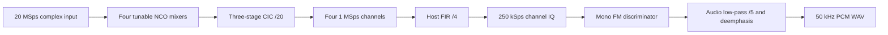

# RF observatory

Record one wideband bladeRF window, select up to four receiver channels, and
compare a fixed-point FPGA model with a floating-point reference. The first
application is mono broadcast-FM reception. The project includes synthesizable
VHDL for the channel bank, explicit hardware-to-host framing, and an integration
patch for each custom transport profile in the pinned bladeRF micro hosted
design.

The normal `capture` command uses the ordinary hosted image. Software reference
outputs and successful HDL simulation do not establish that custom gateware was
fitted, loaded, or tested on a board. Board synthesis and hardware qualification
are separate steps described in the [HDL guide](../hdl/README.md).

## Processing stages



Rust implements capture orchestration, file parsing, reference DSP and HDL
verification. VHDL describes the clocked FPGA datapath and integrates directly
with Nuand's existing VHDL design and Quartus flow. The upstream build system
retains its own languages. This hardware-description scope does not change the
workspace's Rust policy for host software.

## Build and check

Use the pinned workspace toolchain and initialize the upstream source checkouts:

```sh
git submodule update --init --recursive
cargo build --locked --release -p rf-observatory -p bladerf-lab
target/release/rf-observatory doctor
```

The Rust application does not link a native SDR library. Live acquisition
launches the separately built `bladerf-lab` radio adapter, which needs the
[native receive stack](../../../docs/SETUP.md). Saved-IQ processing and fixture
generation require no radio. HDL verification additionally needs **GHDL 6.0.0**
or a separately qualified compatible version. The tested host target is Linux;
process supervision and private file modes use Unix interfaces.

## Record and inspect a wideband window

```sh
target/release/rf-observatory capture --center-mhz 98 --duration 0.5 --antenna 1 --gain 40 --output captures/observatory
target/release/rf-observatory survey captures/observatory/wideband.sc16q11 --center-mhz 98 --output artifacts/observatory-spectrum
```

Select the receive connector carrying the intended feed. Acquisition uses
20,000,000 complex samples/s and little-endian, interleaved SC16 Q11. Each sample
occupies four bytes; one second is 80,000,000 bytes. Duration is bounded to ten
seconds and must provide at least 8,192 samples for spectrum analysis.

The acquisition sidecar retains actual tuning, rate, bandwidth, gain and start
time. The wrapper validates sample representation, settings and completed byte
length. RF tuning readback can differ slightly because of synthesizer
quantization; the wrapper accepts up to 10 Hz while retaining the readback.
The automatic capture spectrum uses that actual center. When replaying files,
supply their known center explicitly rather than inferring it from a filename.

`spectrum.json` contains an averaged Hann-window spectrum, energy-ranked
candidate centers and `activity_detection`. It is schema version 1 with
operation `offline_rf_spectrum_survey`, allowing consumers to reject an
incompatible producer contract before interpreting its numeric fields. Each FFT
window has its Hann-weighted complex mean removed before analysis. Candidate scoring excludes
every ±80 kHz integration that overlaps the ±100 kHz center guard, where a
zero-IF receiver artifact and the deliberate DC removal make signal inference
unsafe. Use an offset follow-up tuning to investigate that guard rather than
treating it as empty. `survey` also writes the DC-removed bins to
`spectrum.csv`.

Activity detection divides the central ±8 MHz into 160 half-open 100 kHz cells.
It triggers a cell when its average is at least 6 dB above the lower-quartile
frequency baseline or a sampled window is at least 6 dB above that cell's
temporal median, then merges adjacent triggers into
`unclassified_spectral_activity` regions. Cell powers are normalized by their
FFT-bin counts. These relative heuristics can be triggered by analog or digital
signals, noise, interference or receiver artifacts; they do not establish a
protocol identity, calibrated power or an occupied channel.
`strongest_trigger_cell_frequency_hz` is the center of the cell maximizing the
larger of its mean frequency-baseline excess and peak temporal-median excess;
it is not necessarily a carrier or the maximum-power cell.

The spectrum uses bounded windows distributed over a bounded input prefix.
When the inspected prefix is long enough to supply the requested count, one
8,192-sample window represents 0.4096 ms at 20 MSps, the default 128 windows
inspect 52.4288 ms in total and the maximum 512 inspect 209.7152 ms. A shorter
prefix clamps the actual count to the number of complete nonoverlapping windows;
the report retains the actual count and sampled duration. Its sampled-window hit
fraction is incidence within those sparse windows, not RF occupancy or continuous
monitoring. Candidate centers remain 100 kHz-grid suggestions, not confirmed
stations.

For short transients, use `survey --dense` to inspect consecutive complete
FFT windows in the selected file prefix, up to 200 million complex samples
with `--max-samples`. It uses the same activity gates and conflicts with
`--windows`. The dense `spectrum.json` reports its stride, analyzed samples
and omitted tail. Hit fractions still describe the inspected file windows.

Add `--events` to a dense survey to write `events.json`. It bounds connected
6 dB temporal power hits by saved-sample index and frequency at the supplied
center. SHA-256 covers the analyzed prefix, four little-endian bytes per
SC16 Q11 I/Q pair. The report keeps up to 4,096 components ranked by peak
excess and counts omissions. Bounds may enclose tiles without hits.
With `--include-band-edges`, the event grid covers the nominal 20 MHz
sampled band with the same center guard. The spectrum summary still uses its
inner activity grid. Edge events describe relative power in saved IQ.
Use `--overlap-events` for a half-window stride (schema 2).
Use `--active-window-ranges` with either stride to write a schema 3 report.
Its slices cover all windows with a hit, including those outside retained
components. Padding, merging and export limits apply to both selections.
Short components up to 400 kHz wide and two through ten windows long can
also report `narrow_contrast_db`. It averages the per-window difference
between the target and its stronger equal-width neighbor. Each cell's
excess is relative to its temporal median. Both neighbors must lie inside
the survey grid and outside the center guard.
Schema 3 also reports up to 128 candidates in `narrow_search` and counts
all qualifying runs. It searches fixed bands one to four cells wide for
two to ten consecutive windows with at least 6 dB of temporal excess and
3 dB of contrast. This can surface a burst inside a wider component.

`slice-events capture.sc16q11 --events events.json --output slices` accepts
captures up to 200 million samples. It checks capture metadata and verifies
the analyzed bytes against the event report's prefix digest.
It writes full-band IQ and replay sidecars for padded, ten-sample-aligned
ranges. Set context with `--pre-roll-samples` and `--post-roll-samples`.
`--merge-gap-samples` joins ranges across gaps up to that size (default zero).
`--coalesce-to-limit` also joins the smallest remaining gaps until the plan
meets `--max-slices`.
Gap samples count toward `--max-total-samples`. That limit and `--max-slices`
apply after merging, before publication.
`slices.json` records source offsets, omitted events and the clipped alignment
tail. The complete private directory is published together without replacement.

Use `probe-waveform` on a saved 20 MSps clip to inspect phase-order and
binary-FSK-like evidence. Supply the clip-local interval, tuning in hertz and
target band center. The interval needs 400 samples of saved context on each
side. The report binds the clip SHA-256 and records spectral-line and
frequency-plateau measurements. Hints describe candidate modulation only.
Supply `--modulation` and `--symbol-rate-hz` to request unframed BPSK, QPSK
or binary FSK symbols. The report requires consistent transitions at the
supplied rate and leaves constellation rotation or bit polarity unresolved.
Use `--search-symbol-rate` to estimate rates from 8 to 200 ksym/s. An
optional `--modulation` restricts the search. Ambiguous or weak clock
evidence yields a report without symbol decisions. Repeated data can
support a lower observable rate.

Use `probe-bursts` with the saved IQ's `--center-hz` and band bounds
`--lower-hz` and `--upper-hz`. It reads up to 20 million samples and reports
power burst intervals on a 51.2 µs grid. Supply `--baseline-samples` for a
quiet prefix or omit it to use the median power of the complete windows.
Repeat `--also-band-hz LOWER:UPPER` for up to seven disjoint companion bands.
The schema 2 receipt gives each band its own threshold bitmap. The first search
window occupies the low bit of the first hex-encoded byte.

Use `probe-ofdm INPUT --start-sample FIRST --end-sample END --output REPORT`
on original-rate 20 MSps IQ. It checks eight-symbol runs for coherent
cyclic prefixes at a 64-sample useful interval and prefix lengths of 8 or 16.
Use `--useful-samples 256` to test prefix lengths of 16, 32 or 64 over
an interval of at least 2,752 samples.
The report binds the clip SHA-256 and records a qualified geometry or an
abstention. A qualified result describes waveform structure and timing.

The native tool can also produce a conventional PSD plot from the IQ sidecar:

```sh
target/release/bladerf-lab analyze captures/observatory/wideband.sc16q11 --output artifacts/observatory-psd.png
```

## Select several FM stations

Use known station frequencies or investigate the spectrum candidates. The
following frequencies are an example configuration:

```sh
target/release/rf-observatory receive captures/observatory/wideband.sc16q11 --center-mhz 98 --stations 92,96,100,104 --max-samples 10000000 --output artifacts/observatory-receivers
```

`capture` also accepts `--stations` to run reference reception after acquisition.
Select one through four distinct frequencies within the central 16 MHz of the
input window. This guard leaves room near the sampled-band edges; antenna and
analog-filter response still affect reception. The model uses a 32-bit phase
accumulator and a 256-entry Q1.15 sine table. Tuning words select the nearest
representable frequency and are recorded in the output request.

Each channel produces:

| File | Meaning |
| --- | --- |
| `channel-N.iq250.cs16` | Filtered 250 kSps little-endian complex signed-i16 IQ |
| `channel-N.wav` | Mono 50 kHz, signed 16-bit PCM audio |
| `receive.json` | Sample counts, clipping/low-power counters and model differences |
| `request.json` | Input context and selected frequencies for standalone replay |

The CIC output has gain 8000/8192 after its arithmetic shift. The following FIR
removes out-of-channel content before further decimation. The chain is not an
ideal brick-wall channel filter: oscillator quantization, CIC droop and alias
rejection limits remain. Strong nearby signals can affect a weak channel.
The reference report includes representative CIC response values and differences
between integer and floating arithmetic.

FM decoding assumes 75 kHz peak deviation, a 15 kHz audio low-pass, a 30 Hz DC
block and 75 microsecond deemphasis. It applies fixed audio scaling, with no
capture-dependent normalization. Silence, noise or an incorrect tuning can
produce audio without establishing a valid broadcast. Stereo and RDS are not
implemented. Filter startup transients remain in the files; the source records
the individual filter delays.

Reference reception is synchronous and bounded by `--max-samples` and
`--timeout`. It does not claim sustained real-time host throughput. The stored
IQ permits replay without another RF observation.

## Deterministic four-channel demonstration

Generate four independent analytic FM carriers without opening a radio:

```sh
target/release/rf-observatory fixture --duration 0.1 --output artifacts/observatory-fixture
target/release/rf-observatory receive artifacts/observatory-fixture/synthetic.sc16q11 --center-mhz 98 --stations 92,96,100,104 --max-samples 2000000 --output artifacts/observatory-fixture-receivers
```

The carriers contain 500, 1000, 1500 and 2000 Hz audio respectively.
`fixture.json` records the analytic waveform definition and its SHA-256.
This is a controlled software input, separate from a recorded RF signal.

## Verify the FPGA implementation

```sh
target/release/rf-observatory verify-hdl --timeout 120 --output artifacts/observatory-hdl
```

The verifier drives the actual VHDL with deterministic samples and compares
each result and saturation flag with the Rust model. It checks Profile-1 and
Profile-2 framing, control, reset and loss handling through the FIFO-write
boundary. It also runs generic GHDL synthesis. The Profile-2 transport check
reconciles the CPU-modeled register transaction with the strict stream parser.
See the [HDL verification guide](gateware.md#verification-and-its-limits)
for the test coverage and the separate Quartus build.

Logs, vectors and netlists stay in the output directory. Cancellation or the
whole-run deadline terminates and reaps the tool process group. A failure
preserves its diagnostics. Fitted timing, image assembly and board operation
require separate checks.

### Verify the qualified Profile-2 image bundle offline

Put the private xA9 Profile-2 image and its hashed reports beside the strict
schema-2 manifest. Provision `config/profile2-approved-manifest.sha256` with
the exact approved digest from a reviewed qualification record. The ignored
checkout-local file contains one 64-character lowercase hex digest. Keep it
separate from the bundle. Supply the same digest when running the verifier on
Linux with `/proc/self/fd`.

```sh
cargo run --locked -p rf-observatory -- \
  verify-profile2-image \
  --manifest build/rf-observatory/images/profile2-pipelined/manifest.json \
  --manifest-sha256 0123456789abcdef0123456789abcdef0123456789abcdef0123456789abcdef
```

The example digest is a placeholder. The verifier requires the manifest bytes,
supplied digest and checkout approval to match before parsing. It checks the
fixed Profile-2 target, timing conditions and report inventory. It rehashes the
maintained Profile-2 sources, integration patch, image and evidence files using
direct regular-file pins. Unknown or duplicate fields, missing or extra source
and report names, malformed hashes and board validation claims fail verification.
The approval binds the exact manifest bytes to this checkout. Keep build
provenance with the bundle and use the recorded source digests to verify the
maintained inputs.

This action contains no native adapter or device call. It does not open USB,
load an FPGA image, configure RF, capture samples, enable a bias tee or
transmit. A successful result qualifies only the preserved offline artifact and
its evidence at verification time. The report contains paths, not durable open
file handles. The guarded session preflight therefore revalidates and stages
exact bytes from pinned descriptors before any device process can start.
This does not establish a reproducible clean rebuild or any board behavior.

## Custom FPGA transport

Both custom FPGA profiles use 32-byte records at a 20 MSps source rate.
Profile 1 uses fixed offsets of -6, -2, +2 and +6 MHz. Profile 2 accepts four
phase words through a stopped-RX transaction and starts the stream with a
CONFIG record. See the [Profile-1 format](gateware.md#profile-1-raw-framed-word-format)
and [Profile-2 format](gateware.md#profile-2-config-first-wire-format) for word
layouts and configuration requirements.

A saved Profile-2 stream can be checked or statistically analyzed on Linux
without hardware:

```sh
cargo run --locked -p rf-observatory -- validate-profile2 saved-profile2.frames
cargo run --locked -p rf-observatory -- analyze-profile2 saved-profile2.frames --output artifacts/observatory-profile2-analysis
```

The validation command is a bounded-memory pass requiring exactly one clean
CONFIG first, at least one DATA record, one receiver and epoch tag, the required
20 MHz source rate, source index 19 followed by exact increments of 20, no
asserted error status, a stable pinned-descriptor identity, extent and
modification metadata, and complete 32-byte records. It hashes every validated
byte and checks cancellation between records. It does not create an immutable
snapshot, infer which image produced the file, or establish RF, USB or hardware
behavior.

`analyze-profile2` applies the same strict CONFIG, status, receiver, epoch and
source-index checks while accumulating fixed four-channel state. Its terminal
`analysis.json` records exact input extent, processed bytes and SHA-256,
CONFIG phase words, source-index bounds, signed component extrema and means,
mean and AC power, complex and AC RMS, peak magnitude, zero/nonzero counts and
signed-i16 numeric-limit hits. The default covers the complete file.
`--max-data-records N` instead analyzes at most N DATA records after CONFIG. If
that selects less than the available extent, the report labels both the
selection and hash as a prefix; extent-derived record-slot counts for the
unprocessed suffix do not claim that suffix was parsed. A limit at or above the
available count still validates and labels the complete file while preserving
the requested limit. Reported channel rate and duration come from CONFIG's
required 20 MHz source-rate contract and factor-20 decimation, not measured or
timestamped time. The report contains raw digital counts, not dBm, RSSI,
occupancy, signal identity, antenna response or an analog-clipping measurement.
Analysis opens no device and performs no USB, FPGA-load, RF, bias-tee or
transmit operation.

Analysis writes and synchronizes `analysis.json.partial` before publishing
`analysis.json` by a no-replace hard link. Cancellation or a late write,
synchronization or publication failure produces no terminal success report,
although the partial file may remain as failure evidence. An existing terminal
or partial output is preserved rather than replaced.

### Check the Profile-2 adapter

Run the CPU-only register IPC and session lifecycle checks from the workspace
root:

```sh
cargo build --locked -p bladerf-profile2-adapter
cargo run --locked -p rf-observatory -- verify-profile2-adapter
```

This action exercises the stopped-RX controller against the fixture process
and checks restoration and recovery with an in-process model. See the adapter
guide for [session-worker checks](../../../tools/bladerf-profile2-adapter/docs/session-qualification.md#device-free-complete-session-worker-qualification),
[process checks](../../../tools/bladerf-profile2-adapter/docs/session-qualification.md#device-free-complete-session-process)
and [loader-neutral library requirements](../../../tools/bladerf-profile2-adapter/docs/native-library.md#loader-neutral-image-transition-build).

The separate `verify-profile2-native-adapter` action requires a verified,
already-loaded Profile-2 image with RX stopped. It claims USB and changes
transport alternate settings, then writes four shadow words and commits them.
Supply `--adapter`, `--library`, the library digest through `--sha256`, and the
complete device serial through `--serial`. Interruption can leave partial
shadow writes or an indeterminate commit. Keep RX stopped and reload or reset
the image, or reconcile its state using a qualified procedure before retrying.
See the [native register server contract](../../../tools/bladerf-profile2-adapter/docs/register-server.md#native-register-server)
for library selection and deadline behavior. Use `capture-profile2` for the
complete load, receive and restoration lifecycle.

### Guarded Profile-2 RAM capture

The `capture-profile2` command reaches the reviewed preflight, one-handle native
session, fresh-recovery path, descriptor-authoritative publication and terminal
record. The following is an argument template, not a portable hardware-
validation result or a recommendation for RF tuning. Checkout-specific board
evidence belongs in ignored local validation records:

```sh
target/release/rf-observatory capture-profile2 \
  --receiver rx1 \
  --center-hz 98100000 \
  --gain-db 40 \
  --records 100000 \
  --phase-0 0x01234567 \
  --phase-1 0x89abcdef \
  --phase-2 0x80000001 \
  --phase-3 0xdeadbeef \
  --max-status-polls 4 \
  --transaction-timeout-seconds 60 \
  --manifest /absolute/path/to/manifest.json \
  --manifest-sha256 "$PROFILE2_MANIFEST_SHA256" \
  --adapter /absolute/path/to/bladerf-profile2-adapter \
  --adapter-sha256 "$PROFILE2_ADAPTER_SHA256" \
  --library /absolute/path/to/libbladeRF.so.2 \
  --library-sha256 "$PROFILE2_LIBRARY_SHA256" \
  --stock-image /absolute/path/to/hostedxA9-v0.16.0.rbf \
  --serial "$BLADERF_SERIAL" \
  --output /absolute/private/profile2-sessions/session-001
```

Set each digest from its separate qualification record. The manifest must also
match the [checkout-local approval](#verify-the-qualified-profile-2-image-bundle-offline).
Use the complete 32-character lowercase hexadecimal serial. The output parent
must already be a trusted canonical mode-0700 directory, and the final session
name must be fresh.
The process verifies its real-directory identity and mode, but not the caller's
ownership or ACL policy. The command never replaces an existing destination or
invents a suffix. Relative paths resolve from the selected workspace, but an
explicit absolute trusted parent makes the publication authority clearest.

`--receiver` selects exactly one bladeRF receive connector; it does not
establish which connector carries the antenna feed. The action claims the
selected USB device, RAM-loads Profile 2, performs the fixed board/RFIC and
device-wide RX-mux setup, enables only the selected RX channel, captures a
bounded stream, stops RX and attempts verified restoration of the frozen stock
image. Success requires verified stock restoration and a durable terminal
record. It exposes no flash, TX, bias-tee, loopback, generic image-role,
sample-format or bandwidth control.

`session.json` is the authoritative session result. A command failure remains a
nonzero result even when durable failure evidence was published; failures before
publication create no output, while a publication-setup failure can leave an
empty new directory. The example phase words are legal examples, not recommended
channel settings. Review the selected connector and complete invocation before
each board run.

### Guarded Profile-1 RAM capture

After building and timing-qualifying a profile-1 image, use the guarded wrapper
for a bounded hardware session. Supply the qualified manifest, the cataloged
stock recovery image, the matching pinned CLI and an explicit device serial:

```sh
export RF_DEVICE_SERIAL=00000000000000000000000000000000 # replace with selected device
target/release/rf-observatory capture-fpga \
  --manifest build/rf-observatory/images/profile1-pipelined/manifest.json \
  --recovery-image downloads/hostedxA9-v0.16.0.rbf \
  --blade-rf-cli "$RF_STOCK_SOURCE/host/build/output/bladeRF-cli" \
  --serial "$RF_DEVICE_SERIAL" \
  --center-mhz 98.1 --antenna 2 --gain 40 --records 100000 \
  --output captures/observatory-profile1
```

`RF_STOCK_SOURCE` is the isolated pinned stock clone created in the HDL guide;
its output directory must still contain the matching `libbladeRF.so.2`. Set
`RF_DEVICE_SERIAL` to the complete serial of the selected device. Obtain the
cataloged stock recovery image with the shared
[release-image procedure](../../../docs/SETUP.md#obtain-compatible-release-images).

One million records represent one second of 20 MSps source time and occupy
32 MB. The command accepts 100,000 through 10,000,000 records. Before opening
the radio it verifies the CLI/library versions and hashes, manifest
schema/profile/device, custom image and maintained HDL/patch hashes, qualified
Quartus/Nios/seed and timing closure, stock-image catalog hash, little-endian
host and a current Linux usbfs quota of at least 64 MiB. It reports a low quota
but never changes privileged host settings. Version probes have a fixed deadline
and do not open the radio. Because the private directory is also the controlled
dynamic-library search path, an explicit `--output` may not contain `:`, `;`, or
`$`.

The manifest and its RBF are a private build package, not tracked inputs. After
the isolated build in the [HDL guide](../hdl/README.md), retain the fitter and
TimeQuest reports, copy the assembled RBF under a descriptive file name, and
place a schema-1 `manifest.json` beside it. `image_file` must be that sibling's
base name. The guarded command requires these fields:

```json
{
  "schema_version": 1,
  "image_file": "profile1-xA9.rbf",
  "image_sha256": "<64 lowercase hexadecimal digits>",
  "image_bytes": 0,
  "device": "5CEBA9F23C8",
  "profile_id": 1,
  "workspace_source_commit": "<complete 40-digit commit>",
  "nuand_source_commit": "fcf9423325ae49f5fdd2e5b52ab68bfc2576ad47",
  "integration_patch_sha256": "<64 lowercase hexadecimal digits>",
  "hdl_source_sha256": {
    "rf_observatory_p.vhd": "<64 lowercase hexadecimal digits>",
    "rf_channel_bank.vhd": "<64 lowercase hexadecimal digits>",
    "rf_channel_framer.vhd": "<64 lowercase hexadecimal digits>"
  },
  "quartus": "23.1std.1 Build 993, Lite Edition",
  "nios_configuration": "tiny",
  "fitter_seed": 1,
  "timing": {
    "checks": 184,
    "negative_checks": 0,
    "minimum_setup_ns": 0.0,
    "minimum_hold_ns": 0.0,
    "minimum_recovery_ns": 0.0,
    "minimum_removal_ns": 0.0,
    "minimum_pulse_width_ns": 0.0,
    "constraints_relaxed": false
  }
}
```

Replace each string placeholder, `image_bytes`, and the five example slacks with
values measured from that build; `negative_checks` must remain zero. Compute
file/source hashes with `sha256sum` and the image byte count with `stat -c %s`.
All five recorded minimum slacks must be finite and nonnegative.
The manifest is a reproducibility assertion rather than signed provenance, so
preserve the reports that substantiate it. The command independently rehashes
the image, integration patch and maintained HDL before device access.

The generated native session selects exactly one RX input, disables loopback,
triggering and every bias tee, uses plain 16-bit transport at 20 MSps/20 MHz,
and never starts TX. Both images are loaded into RAM with `--load-fpga`; the
command never uses the flash-writing option. Verified private copies of the CLI,
matching library and both images are staged in the session directory before
device access, and both native runs use that staged library in a cleared process
environment. Stock
restoration is attempted immediately after the native capture on success,
failure, timeout or interruption, before full-file validation. Success requires
the native idle/no-error report, SuperSpeed USB, actual firmware, rate,
bandwidth, frequency and gain readbacks, exact synced file length, every
profile-1 frame from source index 19 through the requested epoch end, and a
verified stock restore. The request record includes the CLI and library
SHA-256s. Raw data and logs remain in the private session directory on failure.

The explicit restore path reports errors. A best-effort unwind fallback cannot
guarantee recovery after `SIGKILL`, host or power loss, device removal or an
unrecoverable USB failure. Check the device state and load the verified stock
image manually if a session reports uncertain restoration. The lower-level
[native procedure](gateware.md#dedicated-native-framed-word-capture) remains
the auditable recovery reference.

### Saved-stream processing

```sh
target/release/rf-observatory decode-fpga recording.framed.cs16 --output artifacts/observatory-framed
target/release/rf-observatory decode-fpga recording.framed.cs16 --validate-only --output artifacts/observatory-validation
target/release/rf-observatory analyze-fpga recording.framed.cs16 --center-mhz 98.1 --output artifacts/observatory-relative-analysis
target/release/rf-observatory analyze-profile2 saved-profile2.frames --max-data-records 100000 --output artifacts/observatory-profile2-prefix-analysis
```

The decoder validates magic, version, profile, source-index progression and
error flags. It refuses flagged saturation, invalid configuration and detected
ADC/transport loss. The profile assumes a 20 MSps source clock; framing does not
measure that clock. Configure and verify the actual rate separately. At that
rate, each payload channel is
1 MSps and the framed transport is 8 million complex slots/s. At four bytes per
slot this is 32 MB/s, compared with 80 MB/s of ordinary full-rate input IQ.
Payload alone is 16 MB/s. These are format rates, not measured USB throughput.

Normal decoding produces IQ and audio for at most one million records by default;
`--max-records` can select a smaller bounded prefix. `--validate-only` instead
streams through every record with bounded memory and produces only `stream.json`,
including the processed byte count and SHA-256. It does not impose the derived-
output record limit. Interruption or any malformed, flagged, discontinuous or
source-changing record fails validation without publishing a success report.

The initial decoder processes the centers selected by profile 1. A complete
framing check alone does not prove which image produced a file or establish
analog RF performance. The [Profile-1 wire contract](gateware.md#profile-1-raw-framed-word-format)
gives exact word layouts and integration restrictions.

`analyze-fpga` is an offline, bounded-memory view of the signed-i16 CIC payloads.
It validates the consumed profile-1 records through the same strict framing,
flag, source-index and receiver checks while accumulating four-channel digital
statistics. By default it processes the complete file. `--max-records` selects
and clearly labels a prefix; it is not full-file validation. At least 8,192
records are required. `--windows` accepts 1 through 512 requested 8,192-point
symmetric-Hann windows; the actual count is limited to nonoverlapping windows
available in the selected range and their deterministic start records are saved.
The first window begins at record zero, so the defined CIC startup transient is
retained rather than silently discarded.

`analysis.json` records component extrema, mean I/Q, DC and AC power, RMS and
peak magnitude, zero samples, numeric-limit hits, exact phase-word offsets and
the validated prefix hash. Four `channel-N-spectrum.csv` files cover the 1 MSps
channel Nyquist range with 122.0703125 Hz bins. Spectrum values are coherent-bin
power: squared DFT magnitude divided by the squared coherent Hann sum, so a
bin-centered complex tone reports its amplitude squared. They are not Parseval
broadband-noise bin powers. Log powers use `32768^2` counts squared as an explicit
0 dB reference; they are `null` when the ratio is undefined. Because complex I
and Q components have separate signed-i16 limits, their combined power can
approach +3.01 dB on that reference. This is a code-value convention, not
calibrated dBFS or dBm.

The optional `--center-mhz` value only labels spectrum bins by adding the
caller-supplied center, exact profile-word offset and residual bin frequency.
That center is not encoded or authenticated by profile-1 framing. CIC droop and
aliasing remain, and the output does not identify signals, stations, a noise
floor, occupancy, antenna response, analog ADC clipping or continuous RF
conditions. The RX1/RX2 flag identifies the selected bladeRF input, not the
physical antenna wiring. Analysis is standalone file processing and opens no
radio.

## Outputs and failure behavior

Use a fresh output directory for each operation. Sessions are private (0700),
data/report files are private (0600), the staged CLI is private and executable
(0700), and existing output names are preserved. Derived IQ and WAV files use
`.partial` staging names until each file is complete. Publishing several outputs
is not a transaction: a late filesystem failure can leave some completed files
and some staging files. No success report is published for a failed receive
operation. Relative-analysis spectra are likewise synced and published before
the terminal `analysis.json`, so a failed analysis has no final JSON report.

Acquisition has an explicit deadline and interruption path. It first signals
the native receiver to stop, allows five seconds for cleanup, then kills and
reaps a stalled worker. Fallback cleanup may block in OS process teardown.
The custom capture ignores cancellation while attempting stock restoration.
Raw IQ and logs remain available when subsequent analysis fails. Native IQ is
untimestamped; completed files do not certify absence of dropped RF samples.

Captures, audio, metadata, build logs and generated tool output belong in the
ignored `captures/`, `artifacts/` and `build/` directories. Shared source and
documentation contain reusable configurations and contracts, not lab results.

References: [Nuand hardware](https://www.nuand.com/bladerf-2-0-micro/),
[pinned FPGA build guide](https://github.com/Nuand/bladeRF/blob/fcf9423325ae49f5fdd2e5b52ab68bfc2576ad47/hdl/README.md),
[Altera CIC compensation note](https://docs.altera.com/api/khub/documents/tdrV3ajc~Z3nVeZC46WdHA/content).
